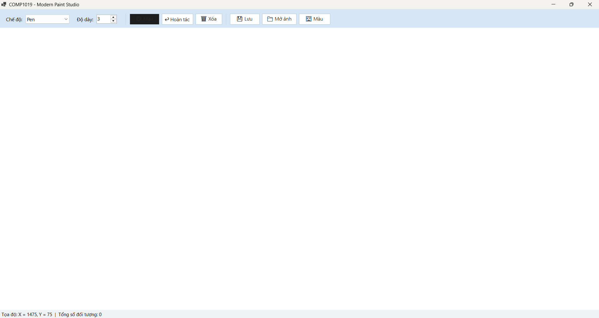
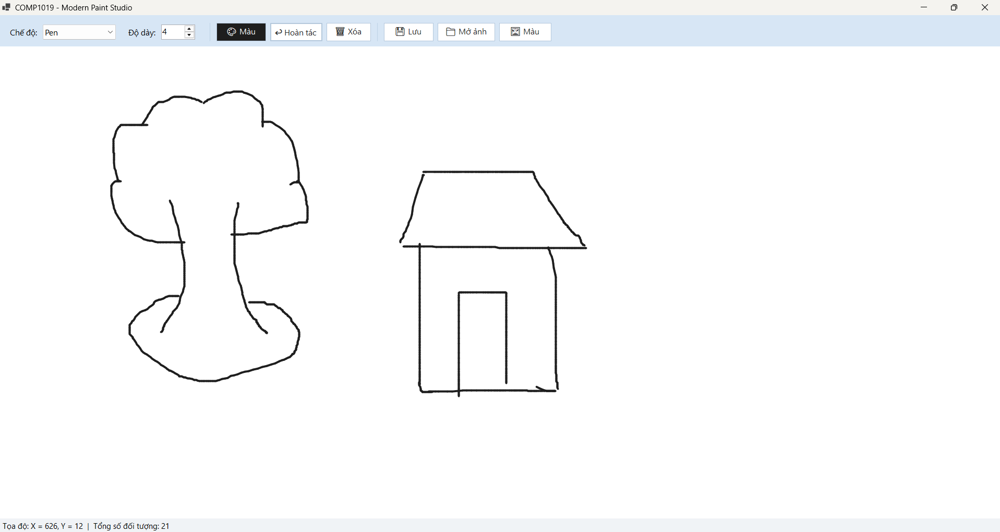
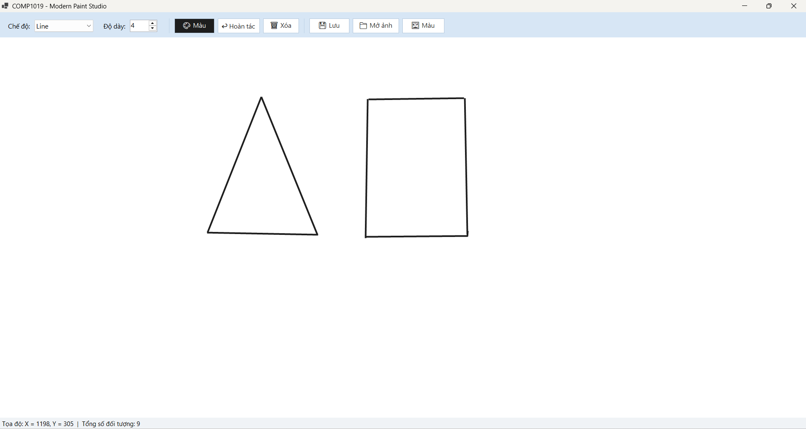
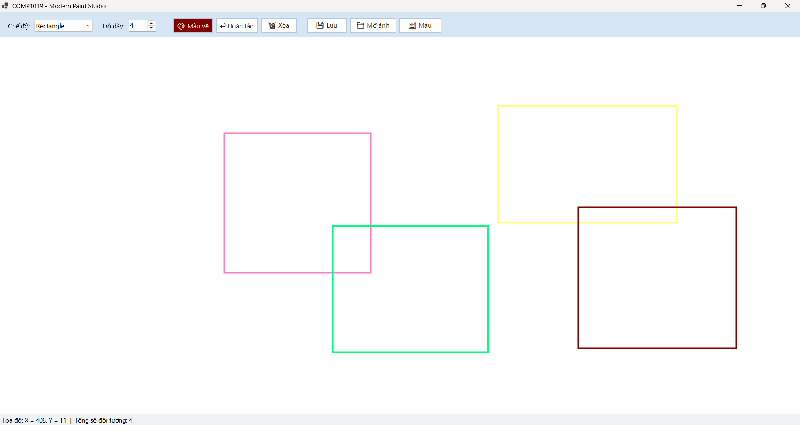
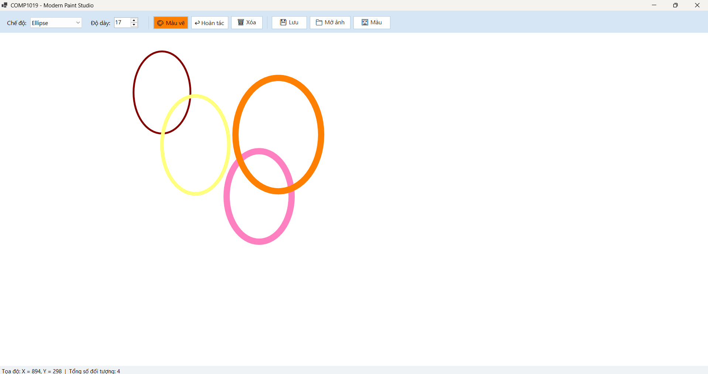
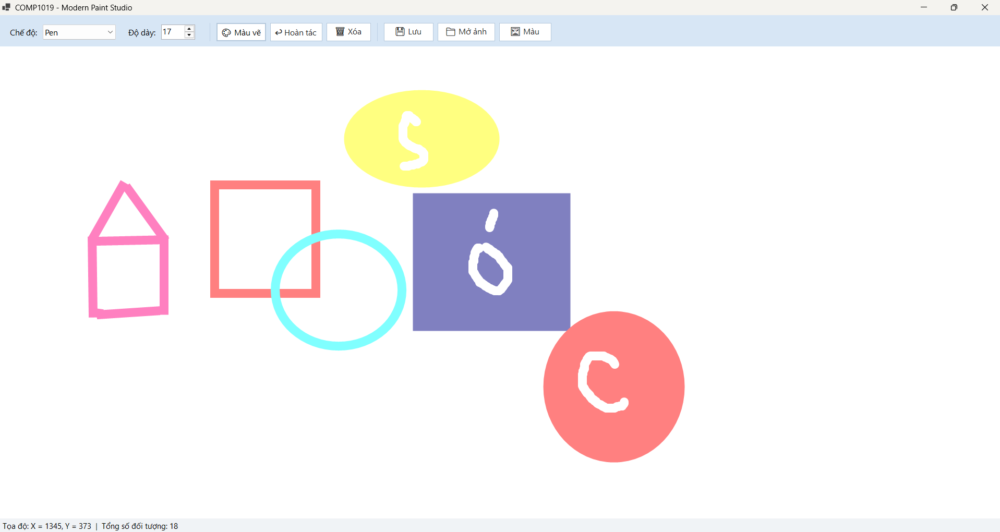
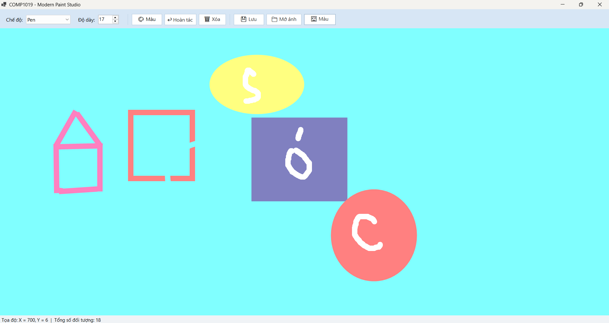

# Lab08 - Modern Paint Studio

## Thông tin sinh viên
- Họ tên: Lê Thị Kim Loan
- MSSV: 49.01.103.045
- Lớp: 49.01.SPTIN.A

## Mô tả
Ứng dụng vẽ tương tác nâng cao xây dựng bằng WinForms và GDI+. Các nét vẽ và hình khối được lưu trữ trong danh sách `List<DrawItem>` và được vẽ lại thông qua sự kiện `Paint`, đảm bảo dữ liệu không bị mất khi resize cửa sổ hoặc khi form bị che khuất rồi hiện lại.

## Cách chạy chương trình

**Yêu cầu:** Windows 10/11, Visual Studio 2022 trở lên và .NET 8 SDK (hoặc .NET Framework tương đương).

**Cách 1: dùng Visual Studio**
1. Mở file project (`.csproj`) bằng Visual Studio.
2. Nhấn **F5** hoặc nút **Start** để biên dịch và chạy chương trình.

**Cách 2: dùng dòng lệnh**
cd COMP1019_Lab08_SimplePaint
dotnet run

## Cách sử dụng

1. Chọn chế độ vẽ trong ComboBox: **Pen**, **Line**, **Rectangle**, **Ellipse**, **FilledRectangle** hoặc **FilledEllipse**.
2. Chọn độ dày nét vẽ từ 1 đến 20 bằng thanh **NumericUpDown**.
3. Nhấn nút **🎨 Màu vẽ** để mở hộp thoại chọn màu sắc (`ColorDialog`).
4. Nhấn giữ chuột trái trên vùng canvas rồi kéo để vẽ. Hình khối sẽ co giãn theo chuyển động chuột và được chốt lại khi thả chuột.
5. Sử dụng nút **↩ Hoàn tác** hoặc phím tắt **Ctrl+Z** để xóa nét vẽ cuối cùng; nhấn **🗑 Xóa hết** để làm sạch toàn bộ vùng vẽ.
6. Tọa độ chuột và tổng số đối tượng được cập nhật liên tục trên thanh trạng thái (`StatusStrip`) ở phía dưới.

## Chức năng

**Bắt buộc:** 
- Vẽ tự do (Pen), đường thẳng (Line), hình chữ nhật (Rectangle), hình ellipse (Ellipse) kéo theo mọi hướng.
- Chọn màu bằng ColorDialog, chọn độ dày bằng NumericUpDown.
- Chức năng Hoàn tác (Undo) và Xóa hết (Clear).
- Hiển thị tọa độ chuột và không bị mất nét vẽ khi resize Form.

**Nâng cao:**

| Chức năng | Cách dùng |
|---|---|
| Lưu bản vẽ ra file PNG | Nhấn nút **💾 Lưu PNG** |
| Mở ảnh nền để vẽ đè | Nhấn nút **📁 Mở ảnh nền** |
| Phím tắt Ctrl+Z để Undo | Nhấn tổ hợp phím **Ctrl+Z** trên bàn phím |
| Vẽ hình chữ nhật / ellipse đặc ruột | Chọn chế độ **FilledRectangle** hoặc **FilledEllipse** trong ComboBox |
| Đổi màu nền canvas | Nhấn nút **🖼 Màu nền** |

## Kỹ thuật chính

- Vẽ trực tiếp trong sự kiện `Paint` của canvas, không vẽ trực tiếp trong sự kiện `MouseMove`.
- Quản lý dữ liệu gốc bằng danh sách `List<DrawItem>`; gọi `canvas.Invalidate()` mỗi khi dữ liệu thay đổi để yêu cầu vẽ lại.
- Sử dụng từ khóa `using` cho các đối tượng đồ họa `Pen` và `SolidBrush` để tự động giải phóng tài nguyên (`Dispose`).
- Xử lý tọa độ hình chữ nhật và ellipse bằng `Math.Min` và `Math.Abs` để hỗ trợ kéo chuột theo mọi hướng.
- Kế thừa từ `Panel` và bật `DoubleBuffered = true` để chống nhấp nháy màn hình khi vẽ tương tác.
- Thiết kế giao diện hiện đại với phong cách Flat Design, bố cục linh hoạt bằng `FlowLayoutPanel` và thanh trạng thái `StatusStrip`.

## Ảnh chụp màn hình

**1. Giao diện khi mở ứng dụng**

**2. Vẽ tự do (Pen)**

**3. Vẽ đường thẳng (Line)**

**4. Vẽ hình chữ nhật (Rectangle), kéo theo nhiều hướng**

**5. Vẽ ellipse**

**6. Vẽ kết hợp nhiều loại hình**

**7. Chức năng nâng cao: mở ảnh nền và vẽ đè lên ảnh**

