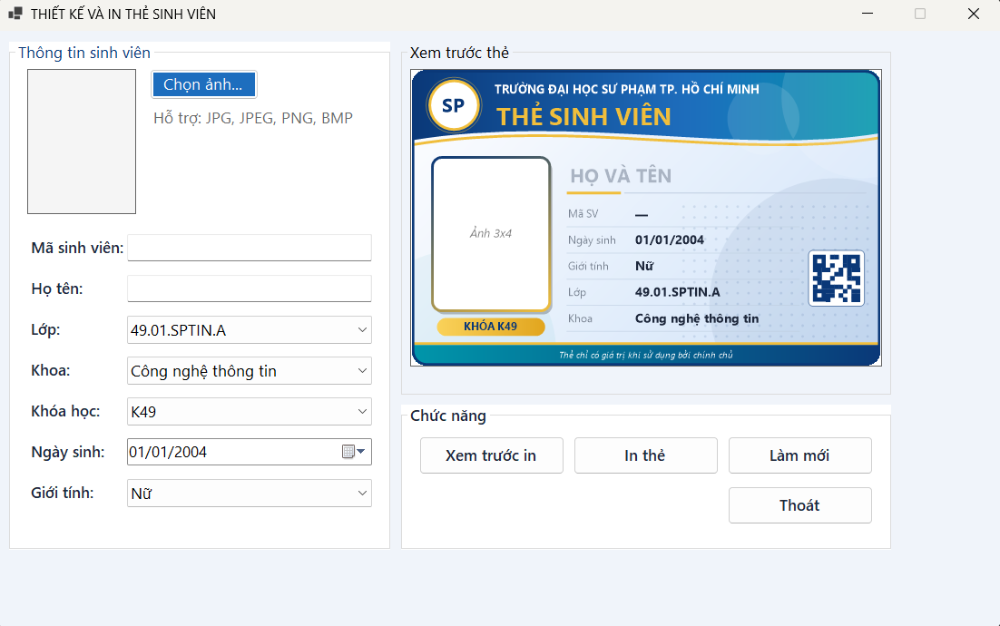
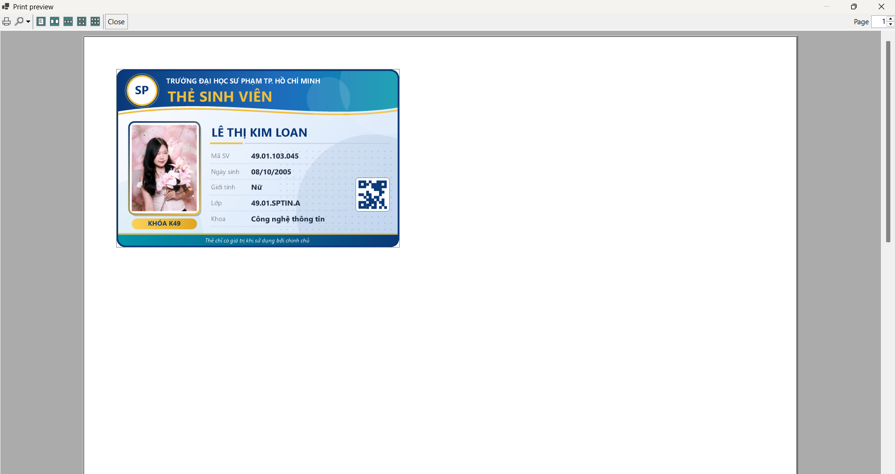
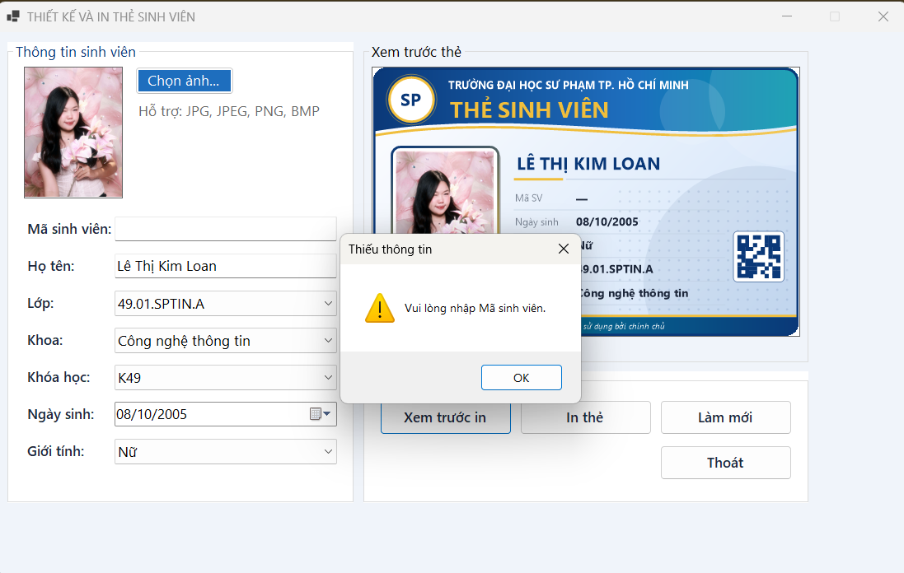
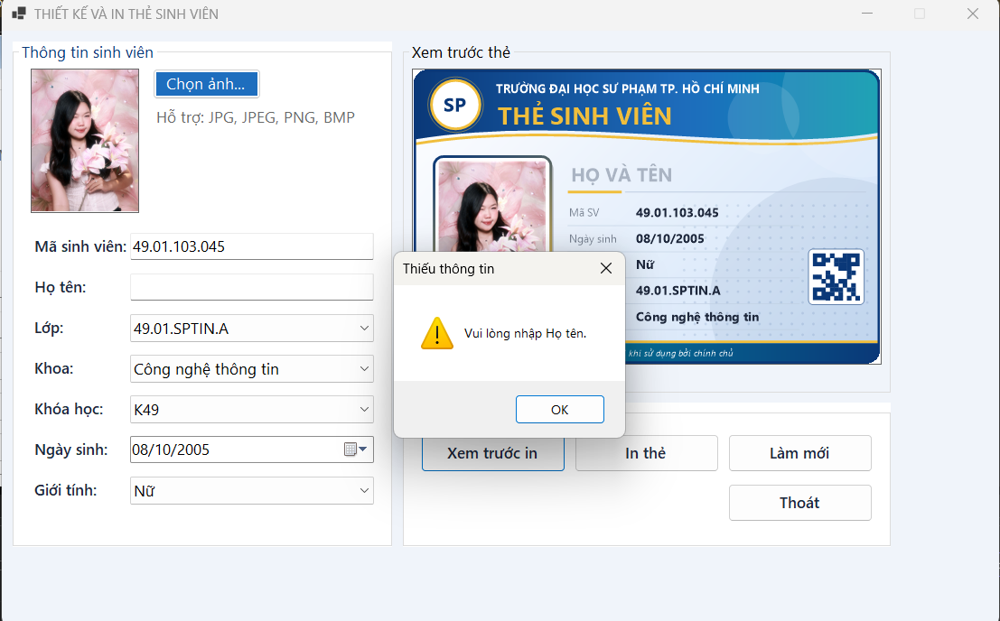
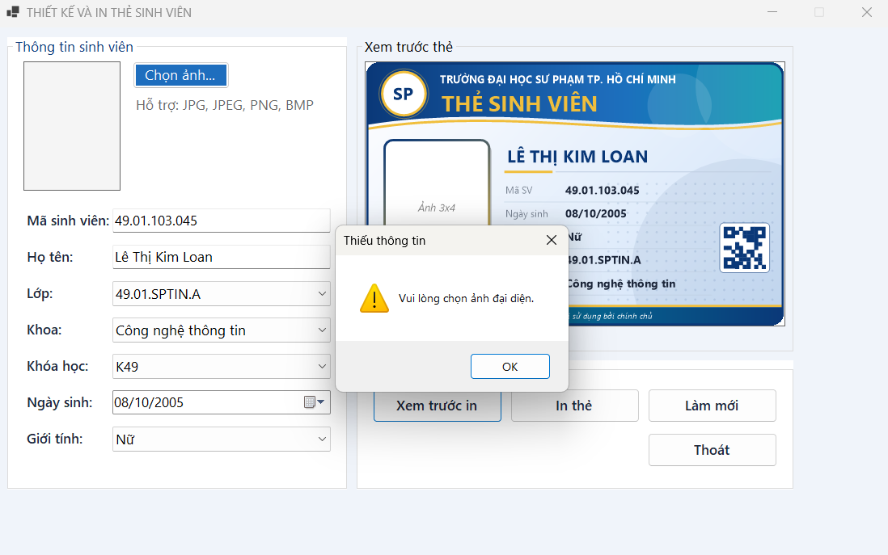
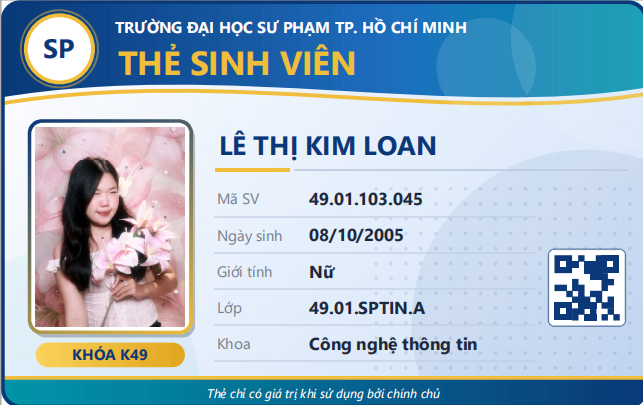
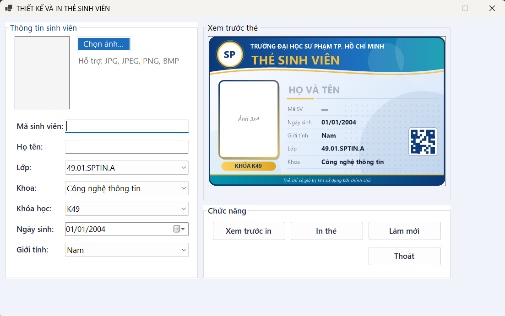

# Lab 09 – Thiết kế và in thẻ sinh viên bằng WinForms

## Thông tin sinh viên

- Họ tên: Lê Thị Kim Loan
- MSSV: 49.01.103.045
- Lớp: 49.01.SPTIN.A

## Mô tả

Ứng dụng Windows Forms cho phép nhập thông tin sinh viên, chọn ảnh đại diện, **xem trước thẻ sinh viên theo thời gian thực** và **in thẻ** (có thể chọn Microsoft Print to PDF). Thẻ được vẽ bằng **GDI+** trên `Panel`, sau đó dùng lại đúng hàm vẽ đó cho `PrintDocument` để bản in giống bản xem trước và có kích thước thẻ thật **85,6 × 54 mm**.

Ứng dụng **không dùng cơ sở dữ liệu**: dữ liệu nhập trực tiếp trên Form. Vì vậy repository không có script database và không có tài khoản demo.

## Công nghệ sử dụng

- C# – Windows Forms (.NET 8)
- Visual Studio 2022
- GDI+ (`Graphics`, sự kiện `Paint` của `Panel`, `LinearGradientBrush`, `GraphicsPath`)
- `PictureBox`, `OpenFileDialog`
- `PrintDocument`, `PrintPreviewDialog`, `PrintDialog`

## Chức năng

### Yêu cầu của đề bài

| Mã | Chức năng | Mô tả |
| --- | --- | --- |
| F1 | Chọn ảnh | `OpenFileDialog` lọc JPG, JPEG, PNG, BMP; ảnh hiển thị trong `PictureBox` chế độ **Zoom** (không méo); nạp ảnh qua bản sao `Bitmap` nên **không khóa file** ảnh gốc khi đổi ảnh. |
| F2 | Preview thẻ | `Panel` vẽ lại thẻ bằng GDI+ mỗi khi dữ liệu thay đổi (gõ chữ, đổi ComboBox, đổi ngày sinh, đổi ảnh). |
| F3 | Validation | Không cho xem trước in/in nếu thiếu **mã sinh viên**, **họ tên** hoặc **ảnh** (kể cả khi chỉ nhập khoảng trắng). |
| F4 | Print Preview | Nút **Xem trước in** mở `PrintPreviewDialog`. |
| F5 | Print | Nút **In thẻ** mở `PrintDialog` và in qua `PrintDocument`. |
| F6 | Làm mới | Nút **Làm mới** (có hỏi xác nhận) xóa dữ liệu nhập, xóa ảnh, đưa Form về trạng thái ban đầu. |

### Chức năng mở rộng đã làm

- Mã **QR giả lập** vẽ bằng ô vuông, hình QR đổi theo Mã sinh viên.
- Nút **Thoát** có hỏi xác nhận.
- Giải phóng ảnh trong bộ nhớ khi đóng Form.

### Thông tin hiển thị trên thẻ

Mã sinh viên, họ tên (in hoa), ngày sinh, giới tính, lớp, khoa, khóa học, ảnh đại diện, tiêu đề **THẺ SINH VIÊN**, tên trường và mã QR.

## Cách chạy

1. Mở file `StudentCard.sln` ở thư mục gốc bằng Visual Studio 2022 (cần workload *.NET desktop development* và .NET 8 SDK).
2. Build Solution.
3. Nhấn **F5** (hoặc `Ctrl+F5`) để chạy project.

## Cách sử dụng

1. Nhập **Mã sinh viên** và **Họ tên** (bắt buộc).
2. Chọn Lớp, Khoa, Khóa học, Ngày sinh, Giới tính.
3. Bấm **Chọn ảnh...** để chọn ảnh JPG/JPEG/PNG/BMP (bắt buộc).
4. Thẻ ở khung bên phải tự cập nhật khi dữ liệu thay đổi.
5. Bấm **Xem trước in** để xem bản in, **In thẻ** để in (có thể chọn Microsoft Print to PDF).
6. Bấm **Làm mới** để xóa dữ liệu, **Thoát** để đóng chương trình.

## Cấu trúc code chính

| Thành phần | Vai trò |
| --- | --- |
| `FrmStudentCard.cs` | Toàn bộ xử lý của Form chính |
| `InitControls()` / `SetDefaultValues()` | Cấu hình control và đưa Form về giá trị mặc định (dùng lại cho nút Làm mới) |
| `LoadAvatar(...)` | Nạp ảnh không khóa file, giải phóng ảnh cũ |
| `ValidateInput()` | Kiểm tra dữ liệu bắt buộc, báo lỗi và đưa con trỏ về đúng ô |
| `DrawCard(...)` | Hàm vẽ thẻ GDI+ dùng chung cho preview và in ấn |
| `DrawImageFit(...)` | Vẽ ảnh vừa khung, giữ đúng tỉ lệ |
| `pdCard_PrintPage(...)` | In thẻ kích thước 85,6 × 54 mm ở góc trên trái trang |

## Hình ảnh minh họa

### Form chính

### Xem trước khi in

## Test case

| STT | Chức năng | Các bước thực hiện | Kết quả mong đợi | Kết quả | Minh chứng |
| --- | --- | --- | --- | --- | --- |
| TC01 | Chọn ảnh | Bấm *Chọn ảnh...*, chọn file `.jpg` | Ảnh hiển thị trong PictureBox đúng tỉ lệ; thẻ cập nhật ảnh ngay | Pass |  |
| TC02 | Lọc file ảnh | Mở hộp thoại chọn ảnh, xem danh sách file | Chỉ thấy file `.jpg .jpeg .png .bmp` | Pass | |
| TC03 | Ảnh không méo | Chọn ảnh ngang, rồi ảnh dọc | Ảnh giữ đúng tỉ lệ, có viền trống nếu khác tỉ lệ 3x4 | Pass | |
| TC04 | Không khóa file ảnh | Chọn ảnh, giữ chương trình chạy, đổi tên file ảnh trong Explorer | Đổi tên được, không báo file đang được sử dụng | Pass | |
| TC05 | Đổi ảnh nhiều lần | Chọn ảnh A, rồi B, rồi C | Không lỗi, ảnh đổi đúng | Pass | |
| TC06 | Preview thời gian thực | Gõ Mã SV, Họ tên; đổi Lớp, Khoa, Khóa học, Giới tính, Ngày sinh | Thẻ cập nhật ngay, họ tên in hoa | Pass |  |
| TC07 | Thiếu mã sinh viên | Để trống Mã SV, bấm *Xem trước in* | Báo “Vui lòng nhập Mã sinh viên.”, không mở preview | Pass |  |
| TC08 | Thiếu họ tên | Nhập Mã SV, để trống Họ tên, bấm *In thẻ* | Báo “Vui lòng nhập Họ tên.”, không mở hộp thoại in | Pass |  |
| TC09 | Thiếu ảnh | Nhập đủ Mã SV, Họ tên, chưa chọn ảnh, bấm *Xem trước in* | Báo “Vui lòng chọn ảnh đại diện.”, không mở preview | Pass |  |
| TC10 | Print Preview | Nhập đủ dữ liệu, bấm *Xem trước in* | Mở PrintPreviewDialog, thẻ có khung, tiêu đề, ảnh, thông tin | Pass |  |
| TC11 | In thẻ | Bấm *In thẻ*, chọn Microsoft Print to PDF | Ra file PDF, thẻ đúng kích thước 85,6 × 54 mm, ảnh không méo | Pass |  |
| TC12 | Làm mới | Nhập dữ liệu và ảnh, bấm *Làm mới*, chọn *Yes* | Ô nhập trống, ComboBox về mục đầu, ngày sinh 01/01/2004, ảnh bị xóa, thẻ vẽ lại | Pass |  |
| TC13 | Thoát | Bấm *Thoát*, chọn *No* rồi *Yes* | *No*: chương trình vẫn mở; *Yes*: chương trình đóng | Pass | |
