# LAB 10 - THIẾT KẾ VÀ CÀI ĐẶT CƠ SỞ DỮ LIỆU EduManagerDB

## 1. Thông tin sinh viên

| Thông tin | Nội dung |
| --- | --- |
| Họ và tên |Lê Thị Kim Loan|
| MSSV | 49.01.103.045 |
| Lớp | 49.01.SPTIN.A |
| Học phần | COMP1019 - Lập trình trên Windows |
| Bài | Buổi 10 - Lab 10 |

## 2. Mô tả

Thiết kế và cài đặt cơ sở dữ liệu **EduManagerDB** trên SQL Server cho ứng dụng quản lý sinh viên.
Cơ sở dữ liệu quản lý: khoa, lớp, sinh viên, môn học, kết quả học tập và tài khoản đăng nhập.
Bài gồm script tạo database, nhập dữ liệu mẫu, các truy vấn SELECT / JOIN / GROUP BY / UPDATE / DELETE
và kiểm thử các ràng buộc dữ liệu.

## 3. Công nghệ sử dụng

- Microsoft SQL Server (Express / Developer)
- SQL Server Management Studio (SSMS)
- Ngôn ngữ T-SQL

## 4. Thiết kế cơ sở dữ liệu

| Bảng | Khóa chính | Khóa ngoại | Ràng buộc khác |
| --- | --- | --- | --- |
| KHOA | MaKhoa | - | - |
| LOP | MaLop | MaKhoa → KHOA | - |
| SINHVIEN | MaSV | MaLop → LOP | CHECK GioiTinh IN (N'Nam', N'Nữ') |
| MONHOC | MaMH | - | CHECK SoTinChi > 0 |
| KETQUA | (MaSV, MaMH) | MaSV → SINHVIEN, MaMH → MONHOC | CHECK Diem BETWEEN 0 AND 10 |
| TAIKHOAN | TenDangNhap | - | DEFAULT VaiTro = 'User', TrangThai = 1 |

Quan hệ: KHOA 1 - n LOP 1 - n SINHVIEN 1 - n KETQUA n - 1 MONHOC.

Quy tắc đặt tên ràng buộc: `PK_<Bảng>`, `FK_<BảngCon>_<BảngCha>`, `CK_<Bảng>_<Cột>`, `DF_<Bảng>_<Cột>`.

## 5. Các file trong bài

| File | Nội dung |
| --- | --- |
| `01_CreateDatabase.sql` | Xóa (nếu có) và tạo database EduManagerDB, tạo 6 bảng với PK, FK, CHECK, DEFAULT |
| `02_InsertSampleData.sql` | Nhập dữ liệu mẫu: 2 khoa, 3 lớp, 7 sinh viên, 4 môn học, 8 kết quả, 2 tài khoản |
| `03_Queries.sql` | 12 truy vấn theo yêu cầu + 3 câu kiểm thử ràng buộc bổ sung |
| `screenshots/` | Ảnh chụp kết quả chạy |

## 6. Chức năng / truy vấn đã thực hiện

1. Liệt kê toàn bộ sinh viên.
2. Liệt kê sinh viên kèm tên lớp và tên khoa (INNER JOIN 3 bảng).
3. Tìm sinh viên theo một phần họ tên (LIKE).
4. Liệt kê sinh viên theo mã lớp.
5. Cập nhật họ tên (SV001) và lớp (SV006) của sinh viên.
6. Xóa sinh viên chưa có điểm (SV007), dùng NOT EXISTS để không xóa nhầm sinh viên đã có điểm.
7. Liệt kê điểm của từng sinh viên theo từng môn.
8. Tính điểm trung bình của từng sinh viên (AVG + GROUP BY).
9. Thống kê số sinh viên theo từng lớp (LEFT JOIN + COUNT).
10. Liệt kê các lớp có từ 2 sinh viên trở lên (HAVING).
11. Test lỗi thêm sinh viên vào lớp không tồn tại (FOREIGN KEY).
12. Test lỗi nhập điểm ngoài khoảng 0 - 10 (CHECK).
13. (Bổ sung) Test giới tính không hợp lệ, trùng mã sinh viên, số tín chỉ = 0.

## 7. Cách chạy

1. Mở SSMS, kết nối vào SQL Server (ví dụ `localhost\SQLEXPRESS`, Windows Authentication).
2. Mở và chạy (F5) `01_CreateDatabase.sql` → tạo database và 6 bảng.
3. Mở và chạy (F5) `02_InsertSampleData.sql` → nhập dữ liệu mẫu.
4. Mở `03_Queries.sql`, bôi đen từng câu truy vấn và bấm F5 để xem kết quả từng câu.
5. Muốn chạy lại từ đầu: chạy lại file 01 rồi file 02.

## 8. Kiểm thử ràng buộc dữ liệu

| STT | Trường hợp | Dữ liệu nhập | Kết quả mong đợi | Kết quả thực tế |
| --- | --- | --- | --- | --- |
| 1 | Sinh viên thuộc lớp không tồn tại | MaLop = 'CNTT99' | Lỗi FK_SINHVIEN_LOP | Đúng |
| 2 | Điểm lớn hơn 10 | Diem = 12 | Lỗi CK_KETQUA_Diem | Đúng |
| 3 | Điểm âm | Diem = -1 | Lỗi CK_KETQUA_Diem | Đúng |
| 4 | Giới tính không hợp lệ | GioiTinh = N'Khác' | Lỗi CK_SINHVIEN_GioiTinh | Đúng |
| 5 | Trùng mã sinh viên | MaSV = 'SV001' | Lỗi PK_SINHVIEN | Đúng |
| 6 | Số tín chỉ bằng 0 | SoTinChi = 0 | Lỗi CK_MONHOC_SoTinChi | Đúng |

## 9. Hình ảnh màn hình

Tất cả ảnh nằm trong thư mục `screenshots/` (19 ảnh).

### 9.1. Cơ sở dữ liệu

#### Sơ đồ quan hệ giữa các bảng (Database Diagram)
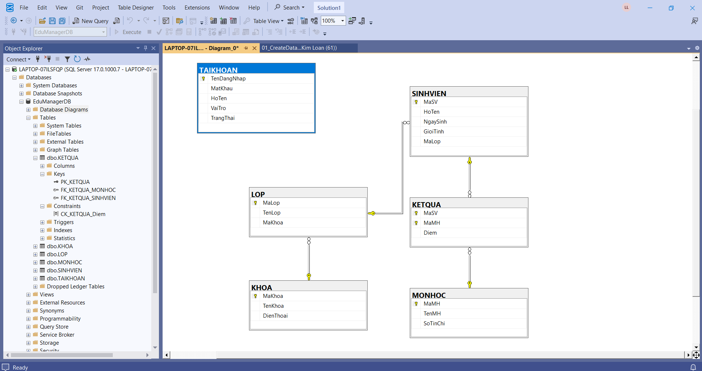

#### Danh sách 6 bảng trong Object Explorer
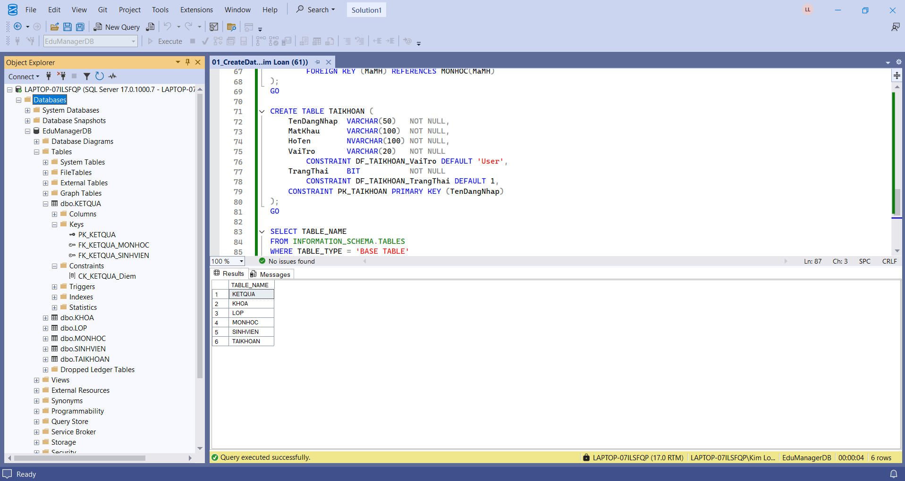

#### Số dòng dữ liệu mẫu của từng bảng
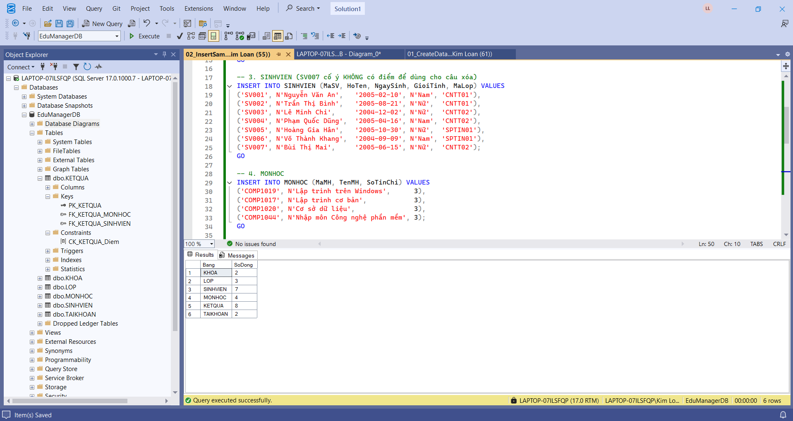

### 9.2. Truy vấn cơ bản

#### Câu 1 - Liệt kê toàn bộ sinh viên
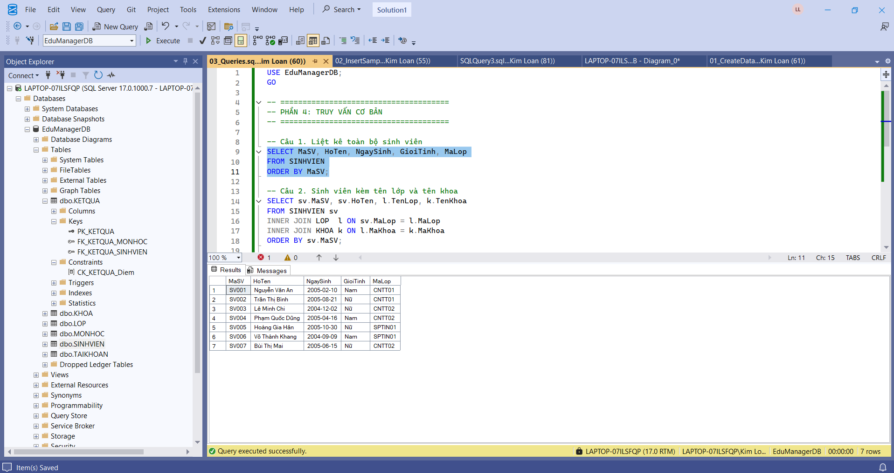

#### Câu 2 - Sinh viên kèm tên lớp và tên khoa
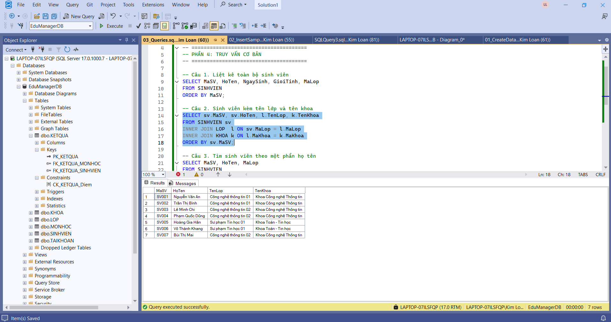

#### Câu 3 - Tìm sinh viên theo một phần họ tên (LIKE)
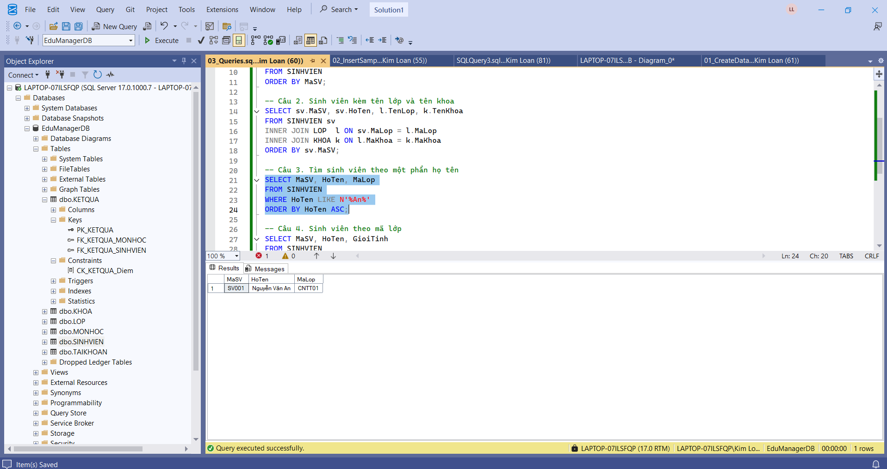

#### Câu 4 - Sinh viên theo mã lớp
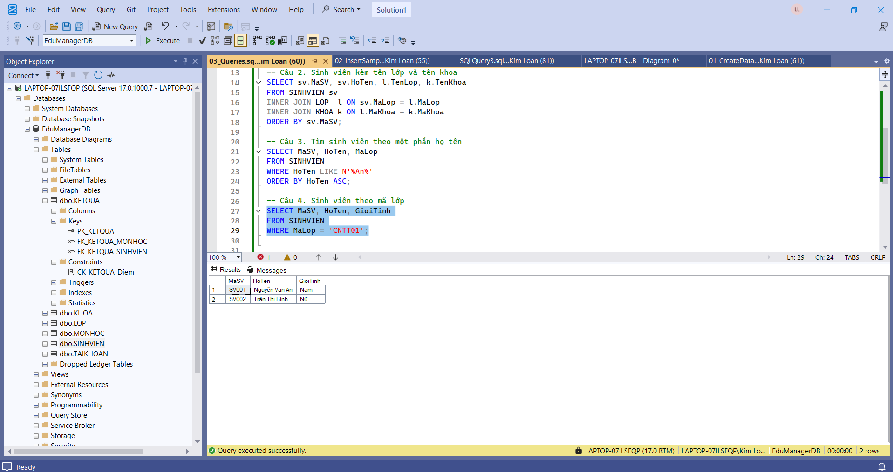

### 9.3. UPDATE và DELETE

#### Câu 5 - Trước khi cập nhật
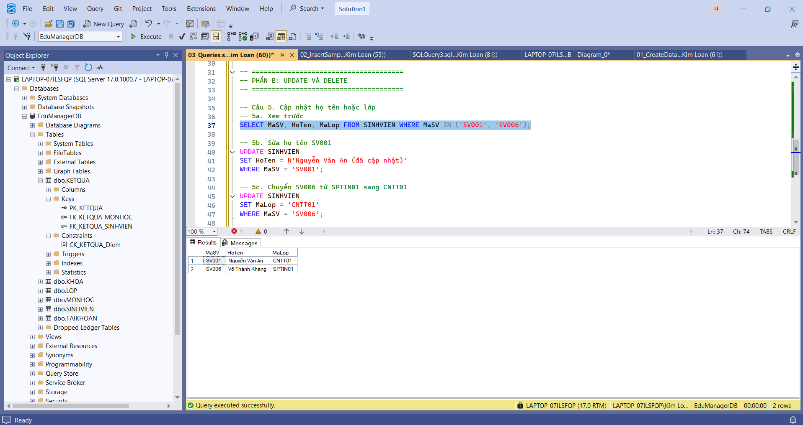

#### Câu 5 - Sau khi cập nhật (SV001 đổi họ tên, SV006 chuyển sang lớp CNTT01)
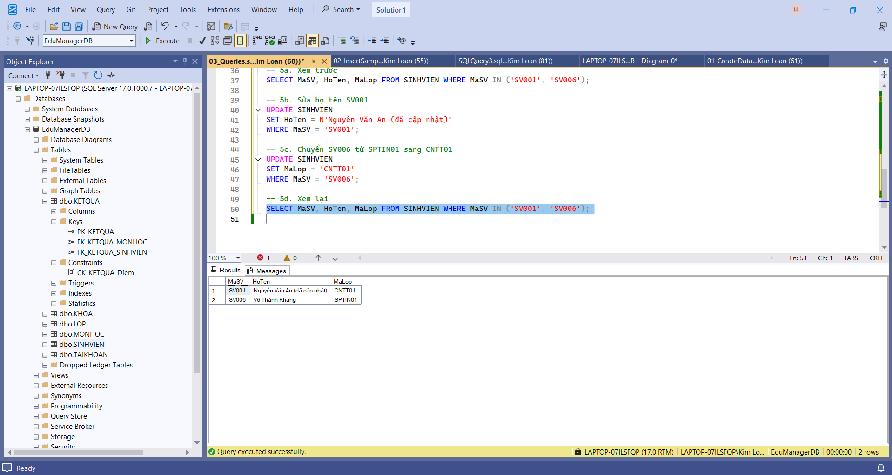

#### Câu 6 - Xóa sinh viên chưa có điểm (SV007)
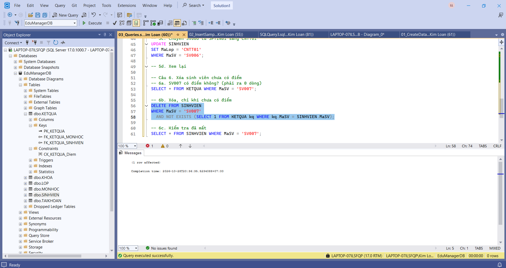

### 9.4. JOIN và thống kê

#### Câu 7 - Điểm của từng sinh viên theo từng môn
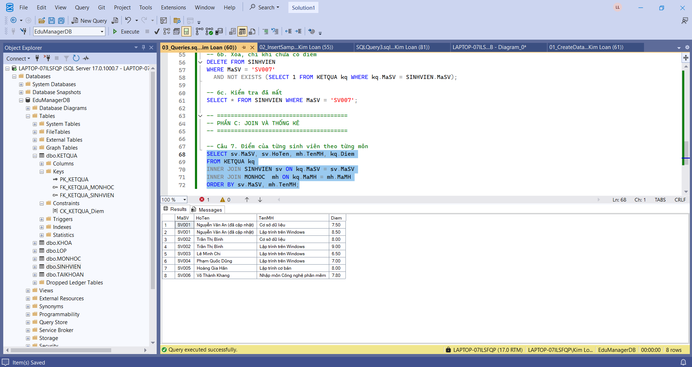

#### Câu 8 - Điểm trung bình của từng sinh viên
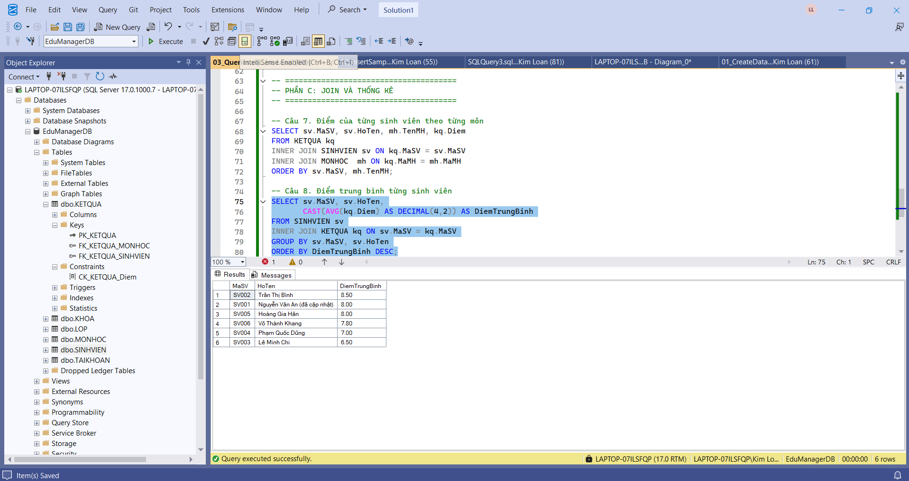

#### Câu 9 - Số sinh viên theo từng lớp
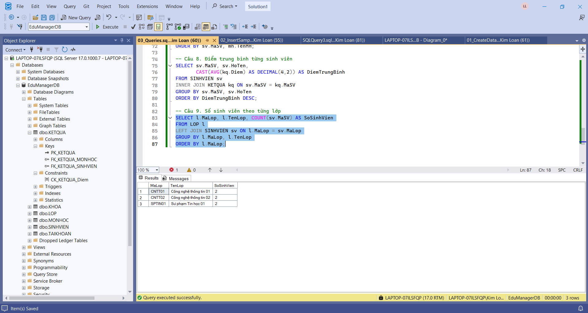

#### Câu 10 - Các lớp có từ 2 sinh viên trở lên (HAVING)
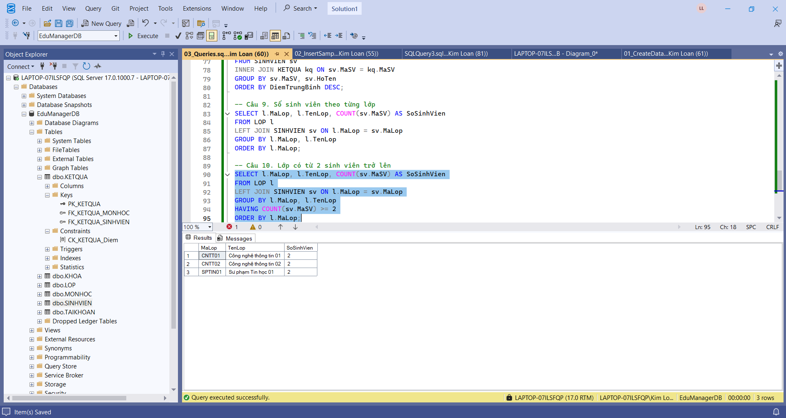

### 9.5. Kiểm thử ràng buộc (các câu phải báo lỗi)

#### Câu 11 - Thêm sinh viên vào lớp không tồn tại (FOREIGN KEY)
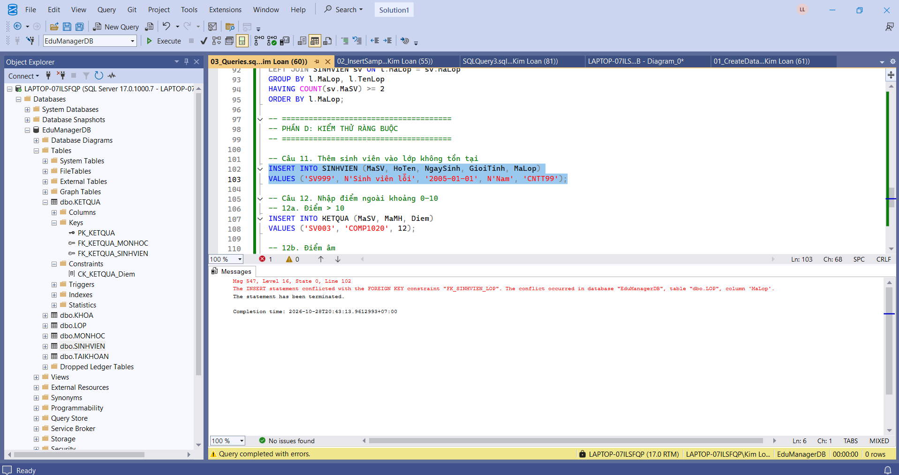

#### Câu 12 - Nhập điểm ngoài khoảng 0 - 10 (CHECK)
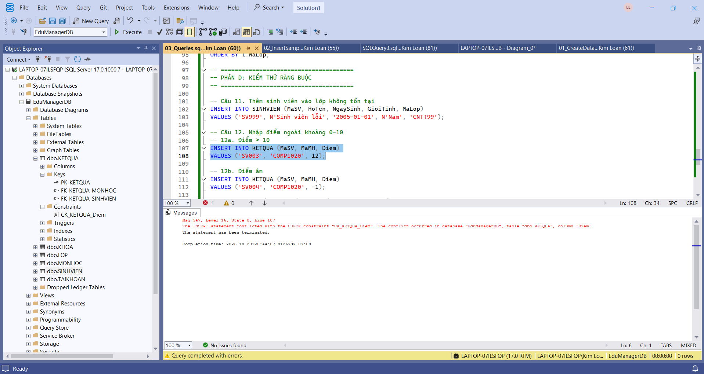

#### Câu 13 - Giới tính không hợp lệ (CHECK)
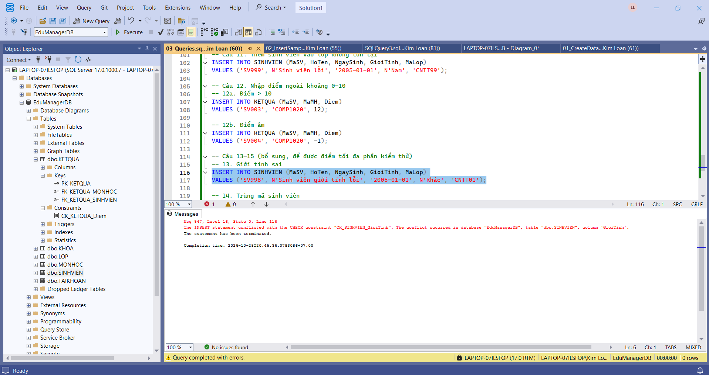

#### Câu 14 - Trùng mã sinh viên (PRIMARY KEY)
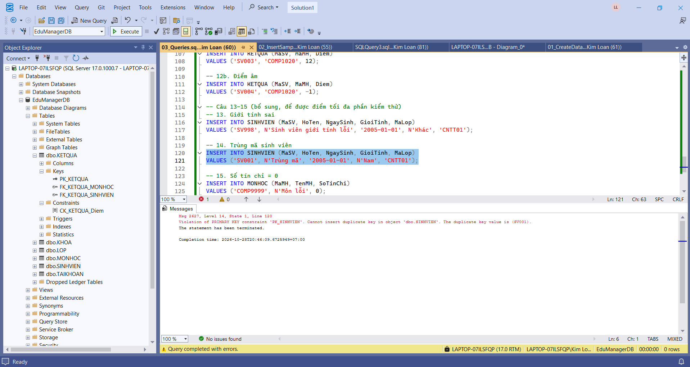

#### Câu 15 - Số tín chỉ bằng 0 (CHECK)
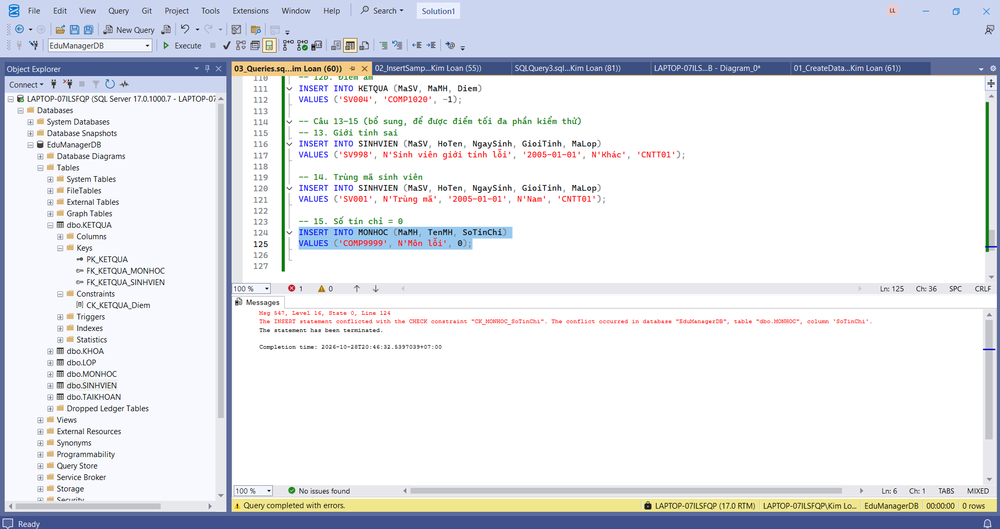

## 10. Kết luận

- Đã tạo database EduManagerDB với đủ 6 bảng, khóa chính, khóa ngoại và các ràng buộc CHECK, DEFAULT.
- Dữ liệu mẫu được nhập đúng thứ tự quan hệ, vượt mức tối thiểu đề yêu cầu.
- Các truy vấn SELECT, JOIN, GROUP BY, HAVING, UPDATE, DELETE chạy đúng.
- Các câu nhập sai đều bị SQL Server chặn, chứng tỏ ràng buộc dữ liệu hoạt động đúng thiết kế.