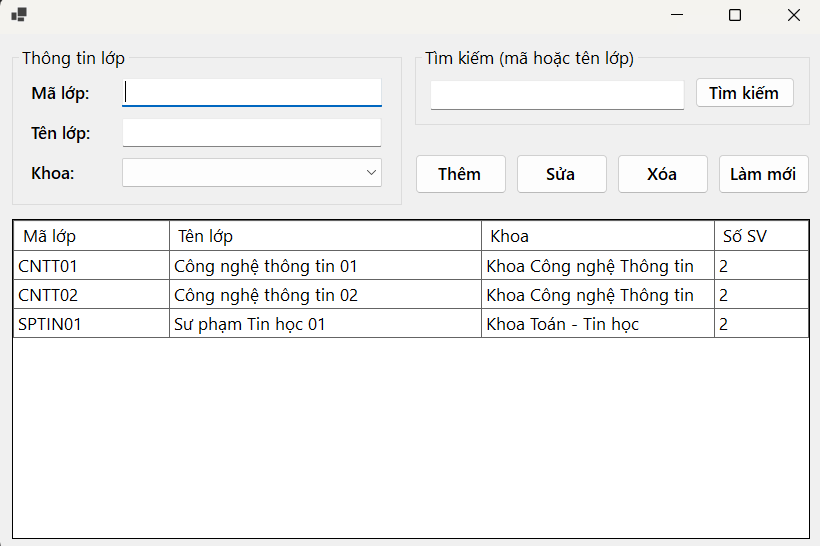
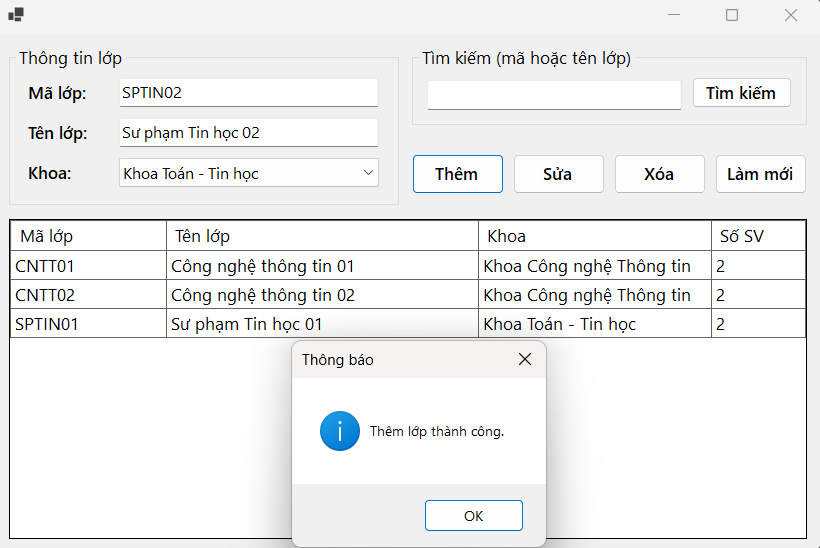
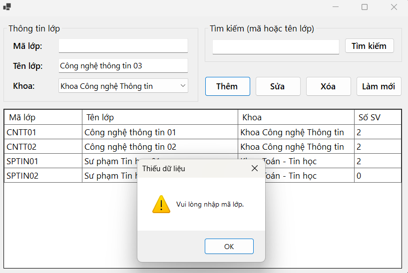
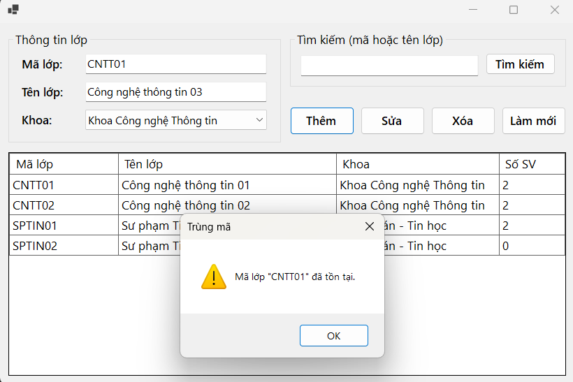
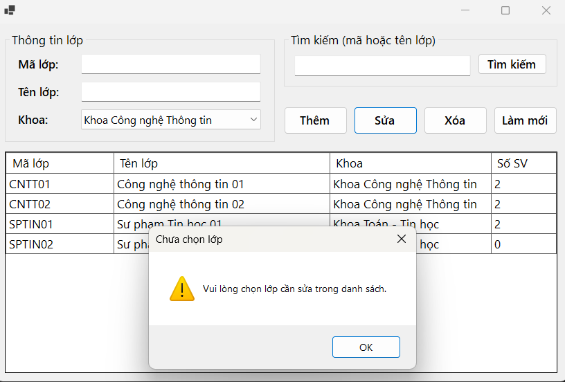
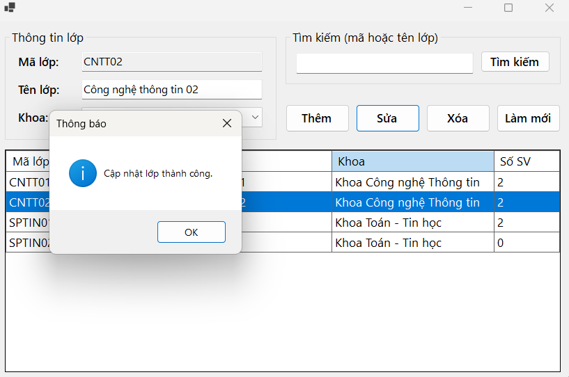
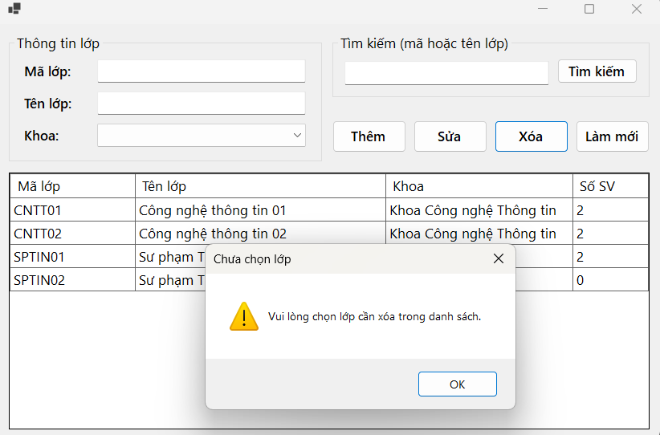
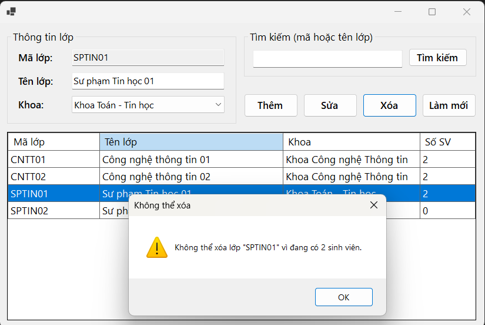
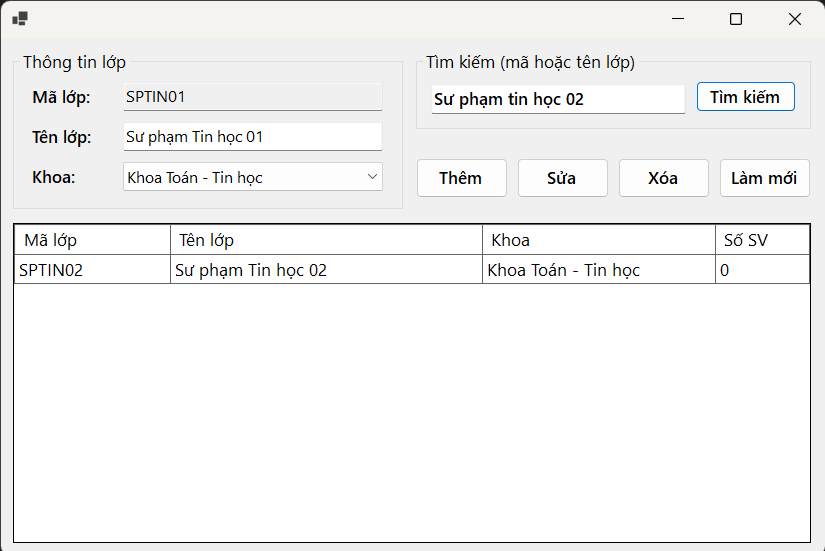
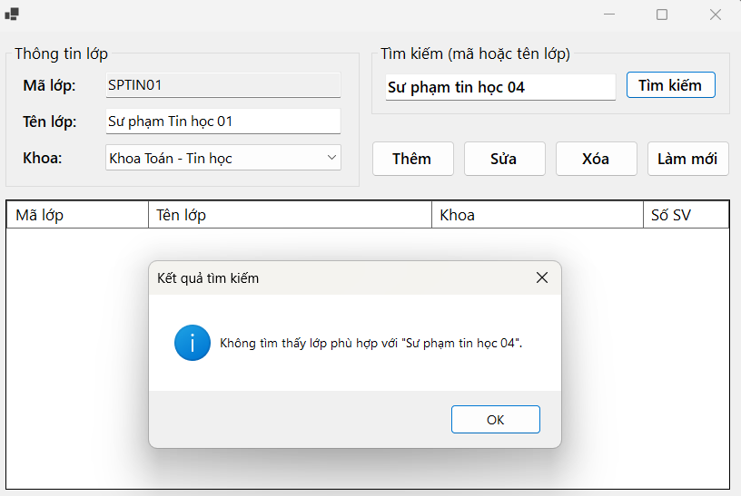

# LAB 11 - ADO.NET VÀ CRUD VỚI SQL SERVER (FrmLop)

## 1. Thông tin sinh viên

| Thông tin | Nội dung |
| --- | --- |
| Họ và tên | Lê Thị Kim Loan |
| MSSV | 49.01.103.045 |
| Lớp | 49.01.SPTIN.A |
| Học phần | COMP1019 - Lập trình trên Windows |
| Bài | Buổi 11 - Lab 11 |

## 2. Mô tả

Ứng dụng Windows Forms **FrmLop** quản lý lớp học, kết nối trực tiếp với database **EduManagerDB**
trên SQL Server bằng ADO.NET. Dữ liệu lớp được đọc và ghi trong SQL Server (không lưu tạm bằng List<T>).
Chức năng: xem danh sách lớp, thêm, sửa, xóa, tìm kiếm lớp; kiểm tra dữ liệu nhập, trùng mã lớp
và chặn xóa lớp đang có sinh viên.

## 3. Công nghệ sử dụng

- C# Windows Forms, .NET 8
- Microsoft SQL Server, SQL Server Management Studio (SSMS)
- ADO.NET với thư viện **Microsoft.Data.SqlClient** (SqlConnection, SqlCommand, SqlDataAdapter, SqlParameter)
- Visual Studio 2022

## 4. Connection string trên máy cá nhân

```
Data Source=.;Initial Catalog=EduManagerDB;Integrated Security=True;TrustServerCertificate=True
```

- Máy cá nhân: `LAPTOP-07ILSFQP`, SQL Server bản mặc định, đăng nhập Windows Authentication.
- Khai báo tại `FrmLop.cs`, biến `connectionString`.
- Máy khác cần đổi `Data Source`:
  - SQL Server Express: `Data Source=.\SQLEXPRESS`
  - LocalDB: `Data Source=(localdb)\MSSQLLocalDB`

## 5. Cấu trúc thư mục

| File / thư mục | Nội dung |
| --- | --- |
| `Buoi11_Lab11/Buoi11_Lab11.sln` | File solution Visual Studio |
| `EduManagerDB.sql` | Script tạo database EduManagerDB (KHOA, LOP, SINHVIEN, MONHOC, KETQUA, TAIKHOAN) và dữ liệu mẫu |
| `Buoi11_Lab11/Buoi11_Lab11/Program.cs` | Điểm bắt đầu, mở FrmLop |
| `Buoi11_Lab11/Buoi11_Lab11/FrmLop.cs` | Code xử lý: kết nối, tải dữ liệu, thêm, sửa, xóa, tìm kiếm, validation |
| `Buoi11_Lab11/Buoi11_Lab11/FrmLop.Designer.cs` | Giao diện form |
| `screenshots/` | Ảnh chụp màn hình khi chạy |

## 6. Giao diện

| Control | Tên | Chức năng |
| --- | --- | --- |
| TextBox | txtMaLop | Nhập mã lớp (bị khóa khi đang chọn lớp để sửa/xóa) |
| TextBox | txtTenLop | Nhập tên lớp |
| ComboBox | cboKhoa | Chọn khoa của lớp (bảng LOP trong EduManagerDB có cột MaKhoa bắt buộc) |
| TextBox | txtTimKiem | Nhập từ khóa tìm theo mã hoặc tên lớp |
| DataGridView | dgvLop | Danh sách lớp: mã lớp, tên lớp, khoa, số sinh viên |
| Button | btnThem / btnSua / btnXoa / btnLamMoi / btnTimKiem | Thêm / Sửa / Xóa / Làm mới / Tìm kiếm |

## 7. Chức năng

| Mã | Chức năng | Cách thực hiện |
| --- | --- | --- |
| F1 | Mở form tự tải danh sách lớp | `FrmLop_Load` → `LoadData()` (SELECT + JOIN KHOA + LEFT JOIN SINHVIEN + COUNT) |
| F2 | Click dòng đưa dữ liệu lên form | `dgvLop_CellClick`, khóa txtMaLop |
| F3 | Thêm lớp | Kiểm tra rỗng, độ dài, trùng mã (`IsMaLopExists`) rồi INSERT |
| F4 | Sửa lớp | Bắt buộc đã chọn lớp; UPDATE tên lớp và khoa theo mã lớp |
| F5 | Xóa lớp | Bắt buộc đã chọn lớp; chặn lớp đang có sinh viên (`CountSinhVienByLop`); hỏi xác nhận; bắt lỗi khóa ngoại 547 |
| F6 | Tìm kiếm | LIKE theo mã lớp hoặc tên lớp với tham số `@kw`; Enter trong ô tìm cũng tìm |
| F7 | Làm mới | Xóa ô nhập, mở khóa txtMaLop, tải lại dữ liệu |
| F8 | Chống SQL Injection | Mọi câu SQL dùng `SqlParameter` có khai báo kiểu, không nối chuỗi |

Code được tách hàm: `ExecuteQuery`, `ExecuteNonQuery`, `ExecuteScalar`, `LoadKhoa`, `LoadData`,
`FormatGrid`, `ValidateInput`, `IsMaLopExists`, `CountSinhVienByLop`, `ClearInput`; mỗi thao tác
với database đều có try-catch.

## 8. Cách chạy

1. Mở SSMS, chạy `EduManagerDB.sql` (F5) để tạo database và dữ liệu mẫu
   (bỏ qua nếu đã có database EduManagerDB từ Lab 10).
2. Mở `Buoi11_Lab11/Buoi11_Lab11.sln` bằng Visual Studio 2022.
3. Nếu máy dùng SQL Express hoặc LocalDB, sửa `Data Source` trong `connectionString` ở `FrmLop.cs`.
4. Bấm F5 (Start) để chạy.

## 9. Kiểm thử

| STT | Tình huống | Dữ liệu test | Kết quả mong đợi | Kết quả thực tế |
| --- | --- | --- | --- | --- |
| 1 | Load form | Mở FrmLop | Hiển thị danh sách lớp từ SQL Server | Đúng |
| 2 | Thêm hợp lệ | TEST01, Lớp test, Khoa Công nghệ Thông tin | Thêm thành công, lưới có TEST01 | Đúng |
| 3 | Thêm thiếu mã | Mã lớp rỗng | Thông báo "Vui lòng nhập mã lớp" | Đúng |
| 4 | Thêm trùng mã | CNTT01 | Thông báo mã lớp đã tồn tại | Đúng |
| 5 | Sửa chưa chọn lớp | Bấm Sửa khi chưa chọn dòng | Thông báo chọn lớp cần sửa | Đúng |
| 6 | Sửa hợp lệ | Chọn TEST01, đổi tên lớp | Cập nhật thành công | Đúng |
| 7 | Xóa lớp chưa có sinh viên | TEST01 | Hỏi xác nhận, xóa thành công | Đúng |
| 8 | Xóa lớp đang có sinh viên | CNTT01 | Không cho xóa, báo "đang có 2 sinh viên" | Đúng |
| 9 | Tìm kiếm | CNTT | Hiện CNTT01, CNTT02 | Đúng |
| 10 | Tìm không có kết quả | XYZ | Thông báo không tìm thấy | Đúng |

## 10. Hình ảnh màn hình

### Form load dữ liệu từ SQL Server


### Thêm lớp thành công


### Thêm thiếu mã lớp


### Thêm trùng mã lớp


### Sửa khi chưa chọn lớp


### Sửa lớp thành công


### Xác nhận xóa lớp


### Không cho xóa lớp đang có sinh viên


### Tìm kiếm


### Tìm không có kết quả
