# LAB 12 - DATA BINDING, STORED PROCEDURE VÀ TRANSACTION

## 1. Thông tin sinh viên

| Thông tin | Nội dung |
| --- | --- |
| Họ và tên | Lê Thị Kim Loan |
| MSSV | 49.01.103.045 |
| Lớp | 49.01.SPTIN.A |
| Học phần | COMP1019 - Lập trình trên Windows |
| Bài | Lab 12 - Data Binding, Stored Procedure và Transaction |

## 2. Mô tả

Module **Quản lý kết quả học tập** (form `FrmNhapDiemTheoLop`). Người dùng chọn lớp và môn học,
tải danh sách sinh viên của lớp, nhập hoặc sửa điểm và ghi chú trực tiếp trên lưới, rồi bấm
**Lưu tất cả**. Toàn bộ điểm được lưu trong **một transaction**: tất cả hợp lệ thì COMMIT,
một dòng lỗi thì ROLLBACK, không dòng nào được lưu.

## 3. Công nghệ sử dụng

- C# Windows Forms, .NET 8, Visual Studio 2022
- Microsoft SQL Server, SSMS
- ADO.NET (**Microsoft.Data.SqlClient**): SqlConnection, SqlCommand, SqlDataAdapter, SqlParameter, SqlTransaction
- DataTable, **BindingSource**, Data Binding cho ComboBox và DataGridView
- Stored procedure

## 4. Connection string

```
Data Source=.;Initial Catalog=QLSinhVienLab12;Integrated Security=True;TrustServerCertificate=True
```

Khai báo một chỗ duy nhất trong `DAL/Database.cs`. Máy dùng SQL Express đổi thành `Data Source=.\SQLEXPRESS`.

## 5. Cơ sở dữ liệu

| Bảng | Khóa chính | Khóa ngoại | Ràng buộc |
| --- | --- | --- | --- |
| LOP | MaLop | - | - |
| SINHVIEN | MaSV | MaLop → LOP | - |
| MONHOC | MaMon | - | SoTinChi > 0 |
| KETQUA | (MaSV, MaMon) | MaSV → SINHVIEN, MaMon → MONHOC | Diem từ 0 đến 10 |

Dữ liệu mẫu: 2 lớp, 8 sinh viên, 3 môn học, 3 điểm có sẵn.

| Stored procedure | Chức năng |
| --- | --- |
| `sp_Lop_GetAll` | Lấy danh sách lớp |
| `sp_MonHoc_GetAll` | Lấy danh sách môn học |
| `sp_KetQua_GetByLopMon` | Lấy sinh viên theo lớp kèm điểm môn học (LEFT JOIN, chưa có điểm thì Diem = NULL) |
| `sp_KetQua_Save` | Lưu một điểm: đã có thì UPDATE, chưa có thì INSERT |

## 6. Cấu trúc thư mục

```
QLSinhVienLab12
├── Program.cs                         (mở form, đặt dấu chấm thập phân)
├── Forms
│   ├── FrmNhapDiemTheoLop.cs          (xử lý giao diện, binding, validation)
│   └── FrmNhapDiemTheoLop.Designer.cs
├── DAL
│   ├── Database.cs                    (connection string)
│   └── KetQuaDAL.cs                   (gọi stored procedure, SaveAll có transaction)
└── Database
    └── QLSinhVienLab12.sql            (tạo database, bảng, dữ liệu mẫu, stored procedure)
```

## 7. Chức năng

| STT | Chức năng | Cách thực hiện |
| --- | --- | --- |
| 1 | Mở form load lớp và môn học | `GetLop()`, `GetMonHoc()` → binding ComboBox (DataSource, DisplayMember, ValueMember) |
| 2 | Tải danh sách sinh viên | `GetKetQuaByLopMon()` → DataTable → BindingSource → DataGridView |
| 3 | Nhập / sửa Điểm, Ghi chú | Cột Mã SV, Họ tên chỉ đọc; ô chưa có điểm tô vàng, điểm sai tô đỏ |
| 4 | Kiểm tra điểm | Không rỗng, là số, từ 0 đến 10; gõ chữ báo lỗi ngay (DataError); con trỏ nhảy tới ô sai |
| 5 | Lưu tất cả bằng transaction | `KetQuaDAL.SaveAll()`: BeginTransaction, gọi `sp_KetQua_Save` cho từng dòng |
| 6 | Lỗi một dòng → rollback | `catch` → `trans.Rollback()` → báo "đã ROLLBACK" |
| 7 | Thành công → commit | `trans.Commit()` sau vòng lặp → báo số dòng đã lưu, tải lại dữ liệu |
| + | Mở rộng | Lọc nhanh theo tên/mã (`BindingSource.Filter`), thống kê sĩ số / có điểm / ĐTB, cảnh báo khi tải lại mà chưa lưu, ô "Bỏ qua kiểm tra" để demo rollback |

Tổ chức code: Form không chứa câu SQL; truy cập dữ liệu tách sang `KetQuaDAL`; connection string
trong `Database`; mọi lời gọi stored procedure dùng `SqlParameter` có khai báo kiểu.

## 8. Cách chạy

1. Mở SSMS, chạy `QLSinhVienLab12/Database/QLSinhVienLab12.sql` (F5).
2. Mở `QLSinhVienLab12/QLSinhVienLab12.csproj` (hoặc file .sln) bằng Visual Studio 2022.
3. Sửa `Data Source` trong `DAL/Database.cs` nếu máy khác.
4. Bấm F5.

## 9. Kiểm thử

Dữ liệu test: lớp **CTK47A - Công nghệ thông tin K47A**, môn **COMP1019 - Lập trình trên Windows**.

| STT | Tình huống | Thao tác | Kết quả mong đợi | Kết quả |
| --- | --- | --- | --- | --- |
| 1 | Mở form | Chạy chương trình | ComboBox có 2 lớp, 3 môn học | Đúng |
| 2 | Lưu khi chưa tải danh sách | Bấm "Lưu tất cả" khi lưới trống | Báo "Chưa có danh sách để lưu" | Đúng |
| 3 | Tải danh sách | CTK47A + Lập trình trên Windows → "Tải danh sách" | 5 sinh viên; SV001 = 8.5, SV002 = 7, SV003 - SV005 trống (tô vàng); Sĩ số 5, Có điểm 2, ĐTB 7.75 | Đúng |
| 4 | Điểm rỗng | Bấm "Lưu tất cả" khi SV003 chưa có điểm | Báo "SV003 - Lê Minh Cường chưa có điểm", không lưu dòng nào | Đúng |
| 5 | Điểm ngoài khoảng | SV003 = 12 | Ô tô đỏ; báo điểm phải từ 0 đến 10, không lưu | Đúng |
| 6 | Điểm không phải số | SV004 gõ "abc" | Báo "Điểm phải là số" | Đúng |
| 7 | Lưu hợp lệ (COMMIT) | SV001 = 8.5, SV002 = 7, SV003 = 6.5, SV004 = 8, SV005 = 7.5 (ghi chú "Thi lại") | "Đã lưu thành công 5 dòng" (2 UPDATE + 3 INSERT); Có điểm 5, ĐTB 7.50; SSMS có 6 dòng KETQUA | Đúng |
| 8 | Lỗi giữa chừng (ROLLBACK) | Tích "Bỏ qua kiểm tra", SV001 = 10, SV003 = 15 → Lưu | SQL Server chặn bởi CK_KETQUA_Diem, báo ROLLBACK; SSMS: SV001 vẫn = 8.5, SV003 vẫn = 6.5 | Đúng |
| 9 | Lọc theo tên | Gõ "Thị" | Chỉ còn Trần Thị Bình, Võ Thị Diễm | Đúng |

Ghi chú test 8: khi lưu, SV001 được ghi thành 10 trước, đến SV003 thì bị lỗi. Nhờ transaction,
thay đổi của SV001 bị hủy theo nên database vẫn giữ 8.5. Không dùng transaction thì SV001 đã thành 10
dù lần lưu báo lỗi.

## 10. Hình ảnh màn hình

### 10.1. Database và stored procedure
4 bảng và 4 stored procedure trong SQL Server.

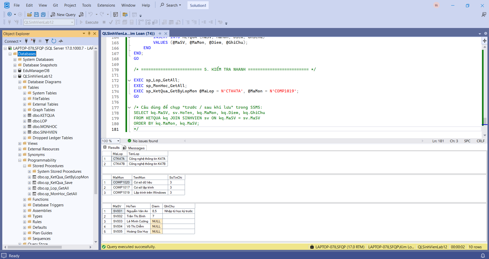

### 10.2. Mở form
ComboBox lớp và môn học được load từ `sp_Lop_GetAll`, `sp_MonHoc_GetAll`.

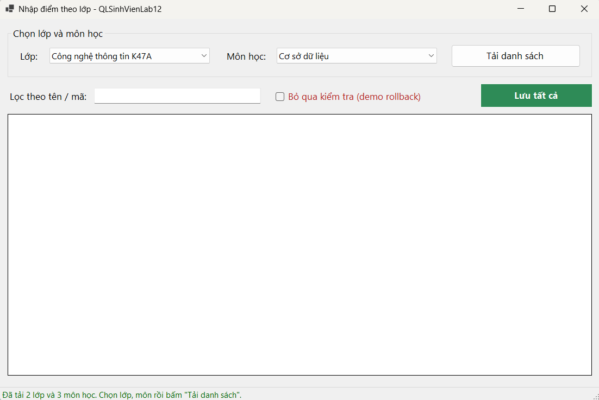

### 10.3. Trước khi lưu điểm
Danh sách lớp CTK47A môn Lập trình trên Windows; 3 sinh viên chưa có điểm (ô vàng).

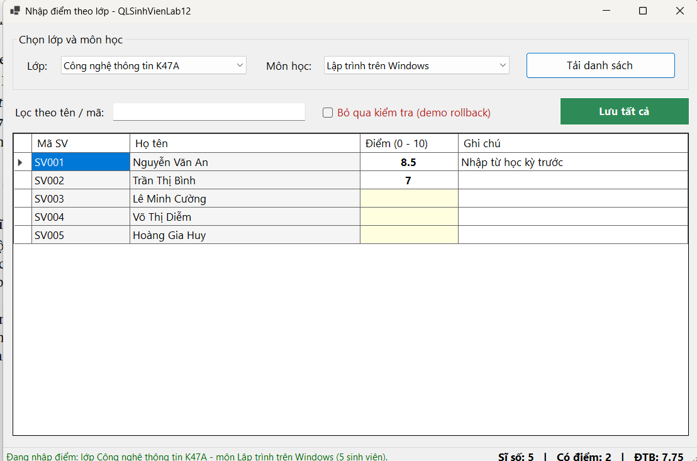

Bảng KETQUA trong SSMS trước khi lưu: 3 dòng.

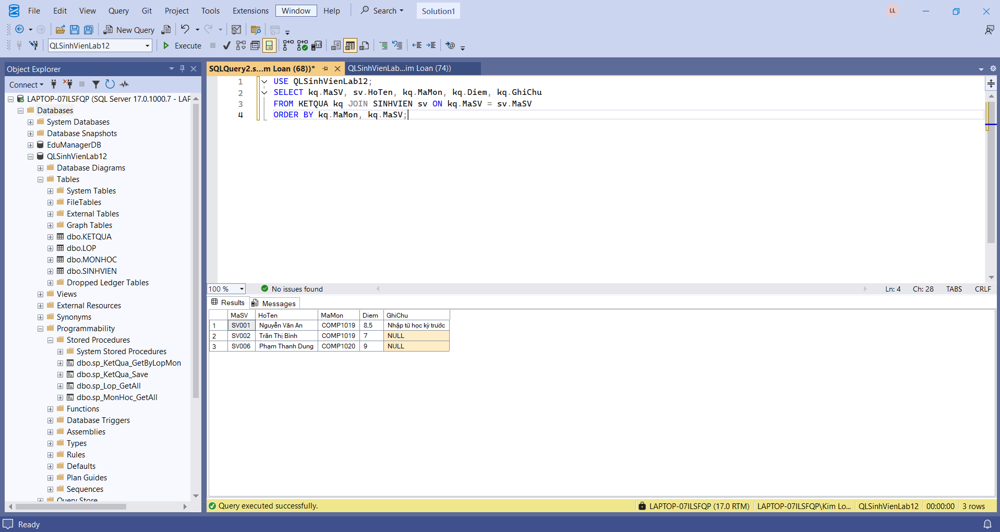

### 10.4. Kiểm tra dữ liệu
Chưa nhập điểm:

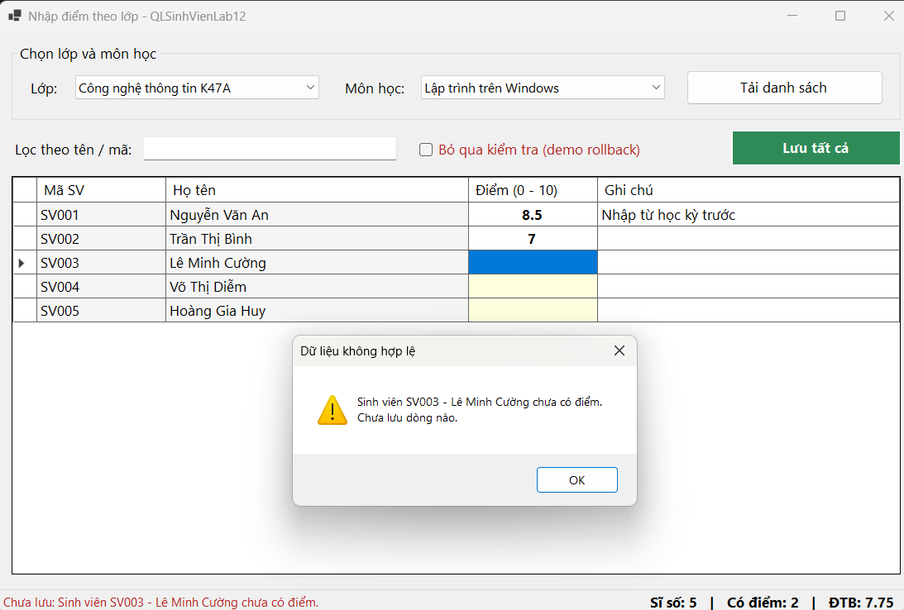

Điểm ngoài khoảng 0 - 10:

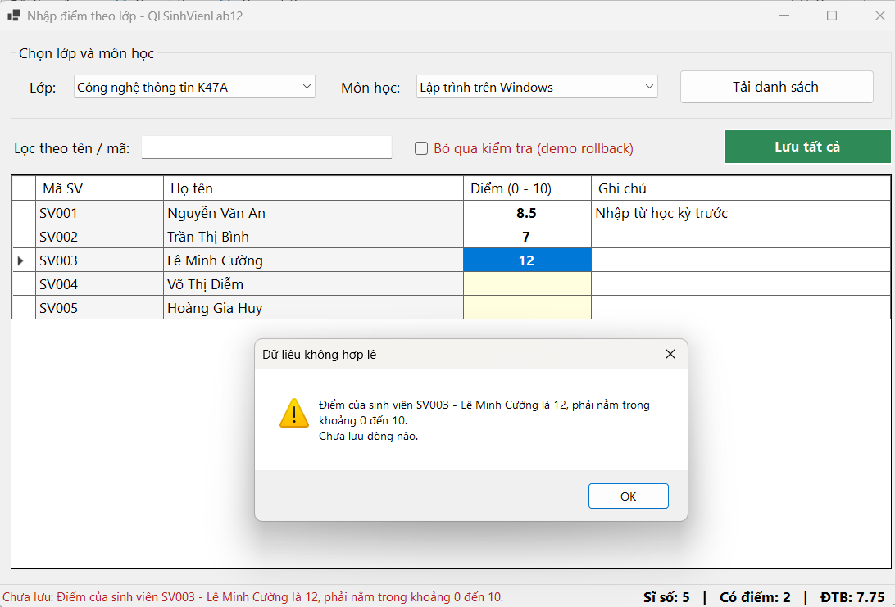

Điểm không phải số:

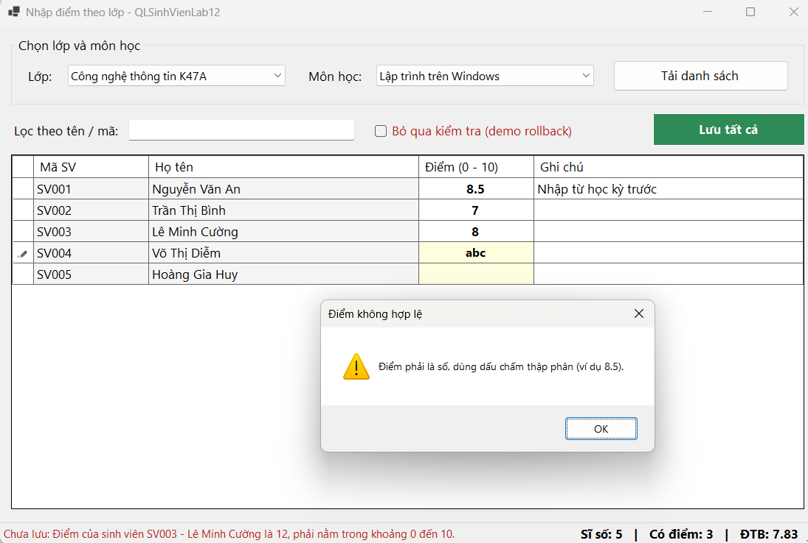

### 10.5. Lưu thành công (COMMIT)

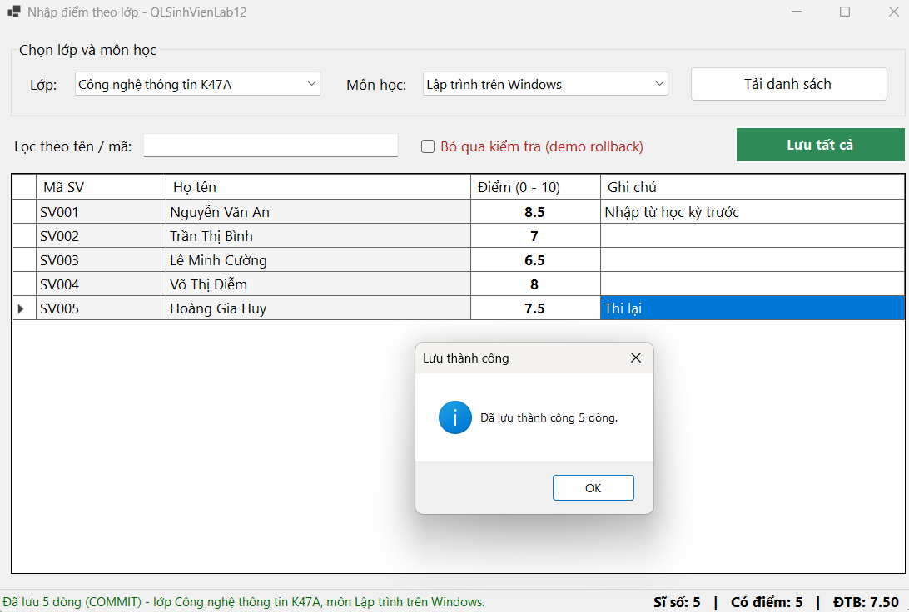

### 10.6. Sau khi lưu điểm
Form tải lại từ database: đủ điểm 5 sinh viên, ĐTB 7.50.

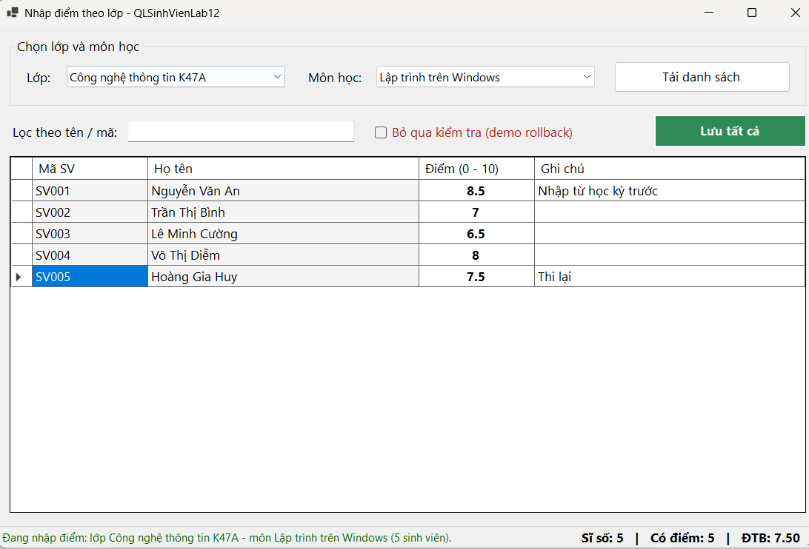

Bảng KETQUA trong SSMS sau khi lưu: 6 dòng.

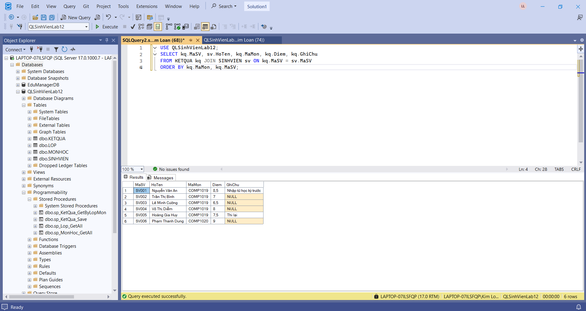

### 10.7. Demo ROLLBACK
Bỏ qua kiểm tra phía Form, nhập SV001 = 10 và SV003 = 15. SQL Server chặn điểm 15, toàn bộ bị hủy.

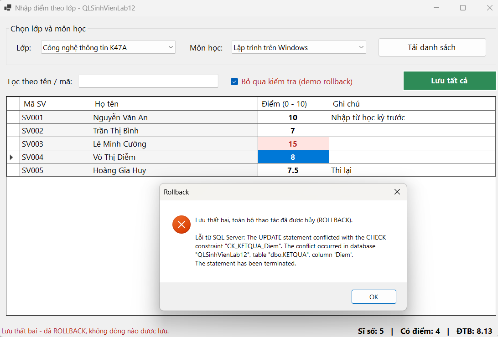

SSMS sau rollback: SV001 vẫn là 8.5, không bị đổi thành 10.

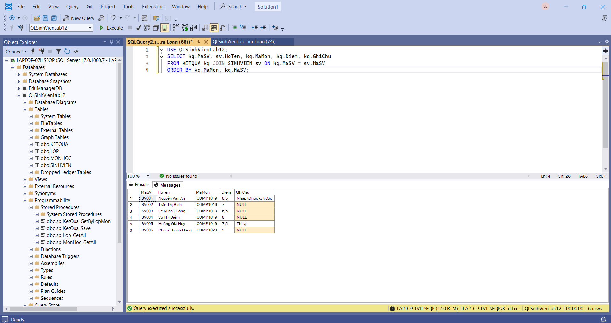

### 10.8. Lọc theo tên (mở rộng)

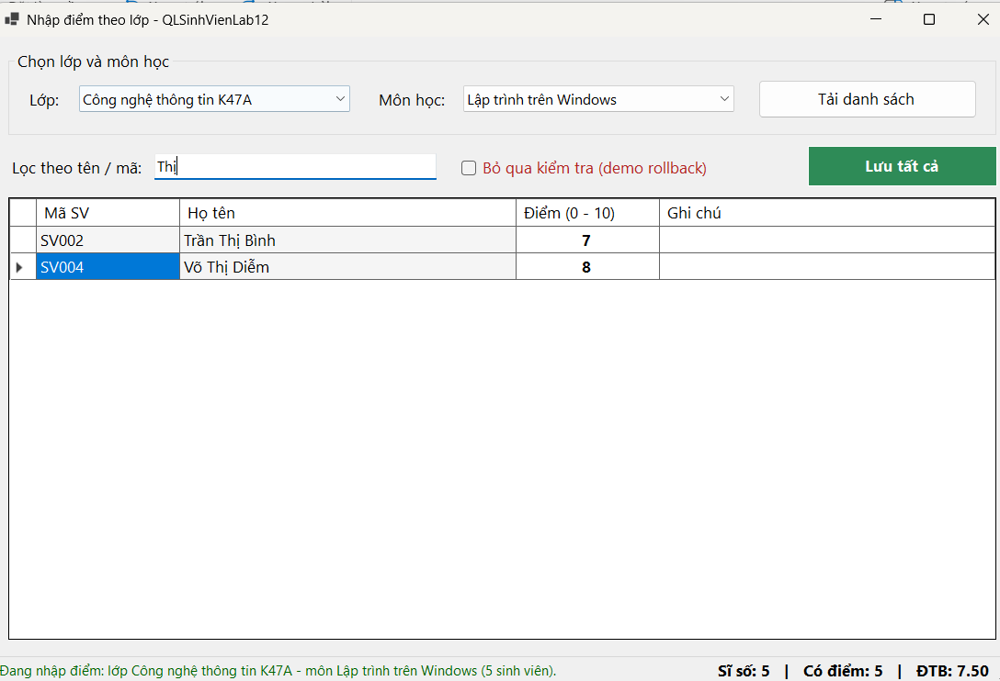