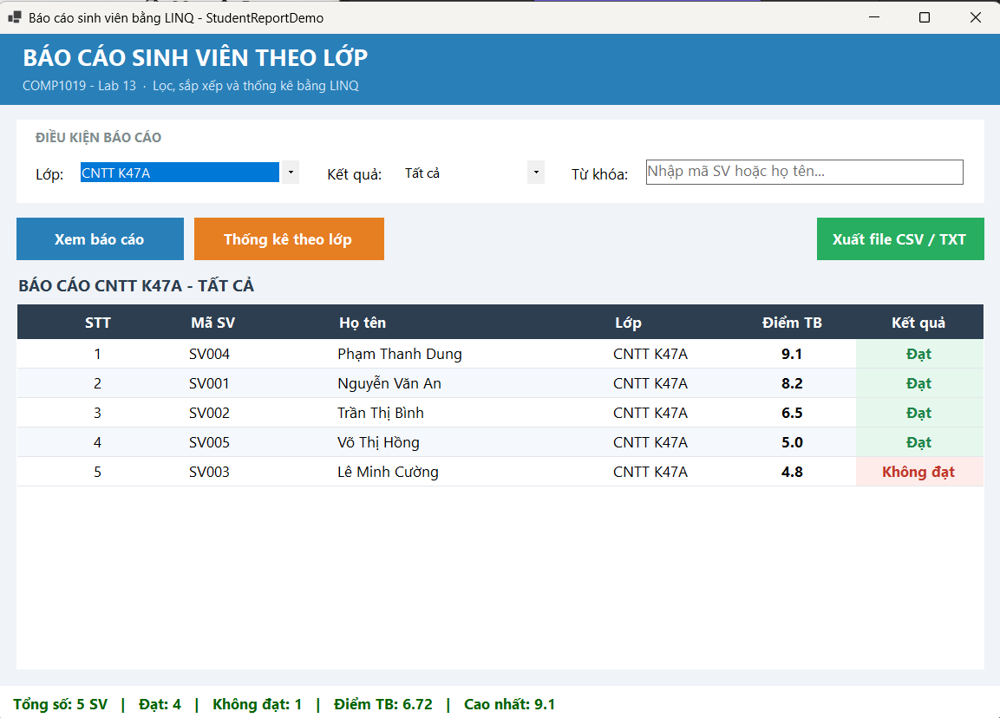
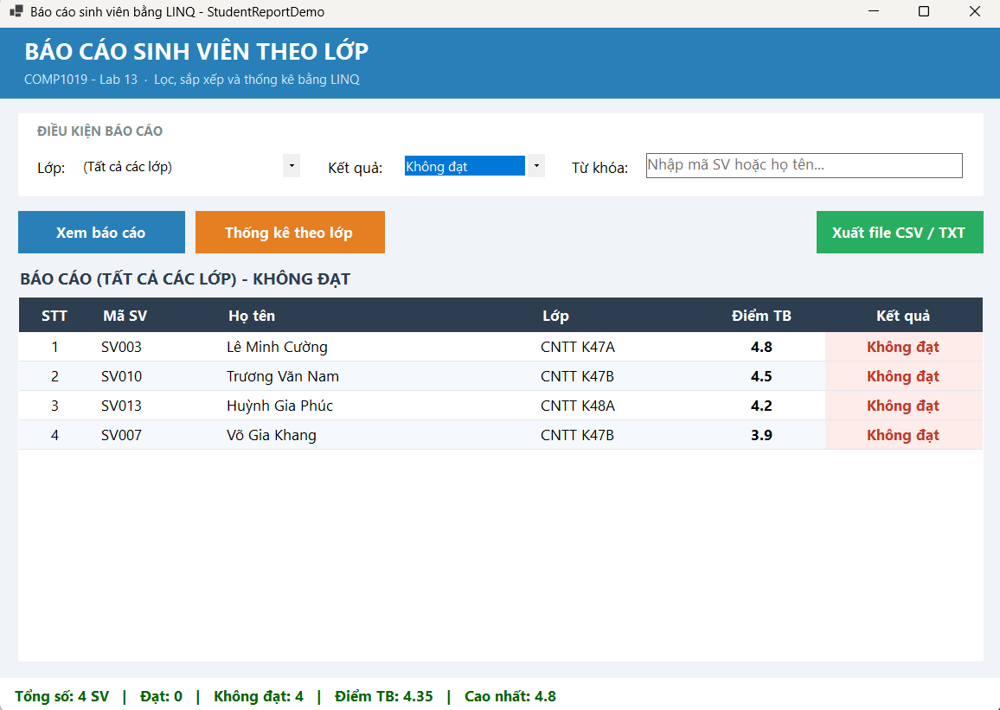
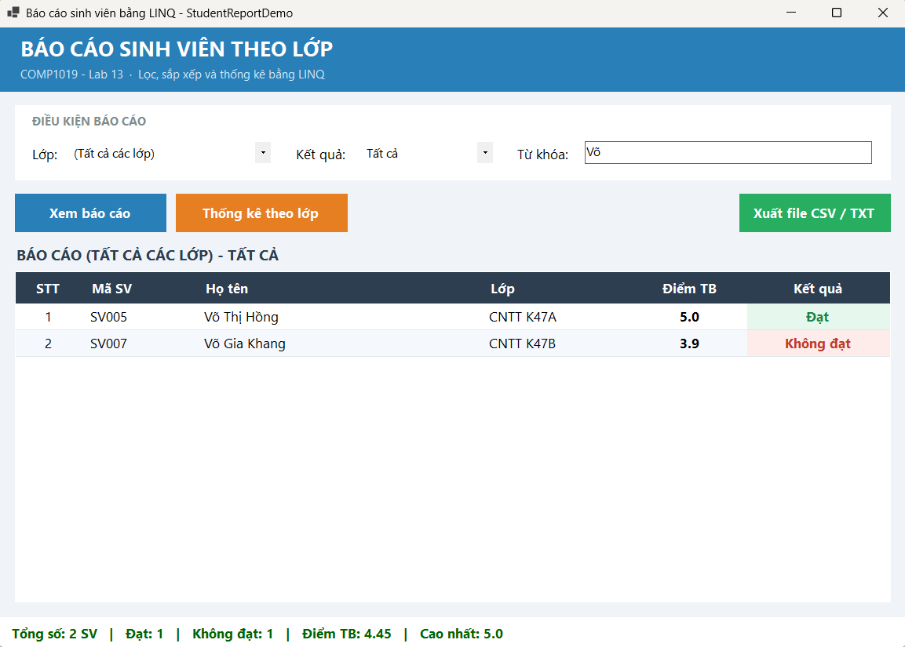
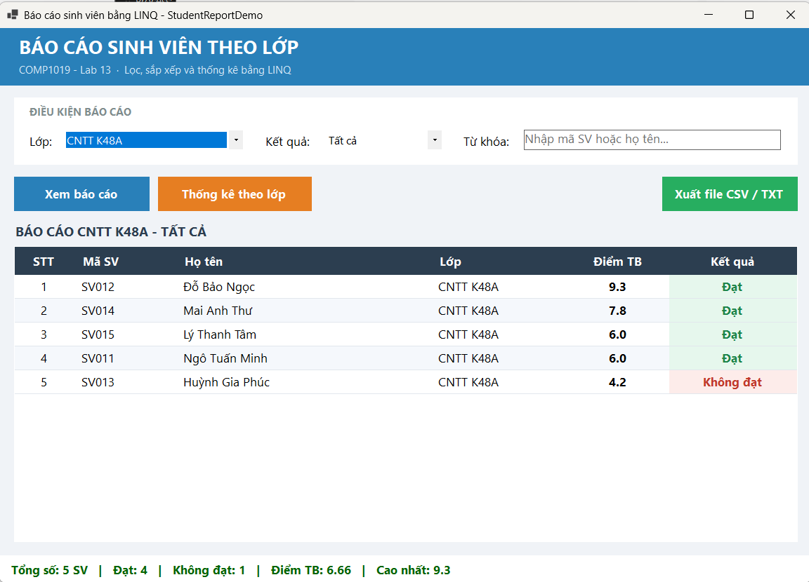
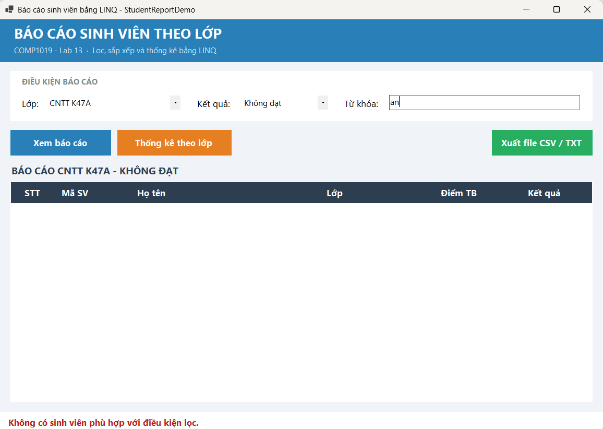
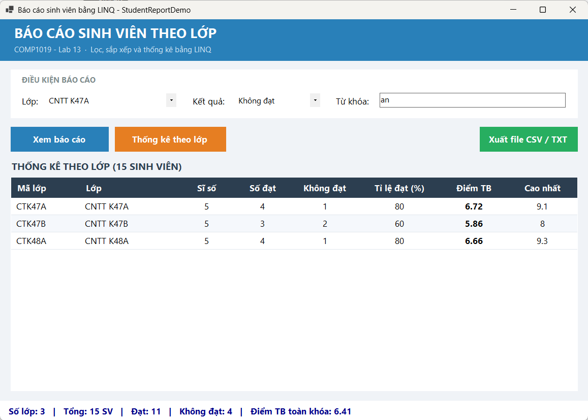
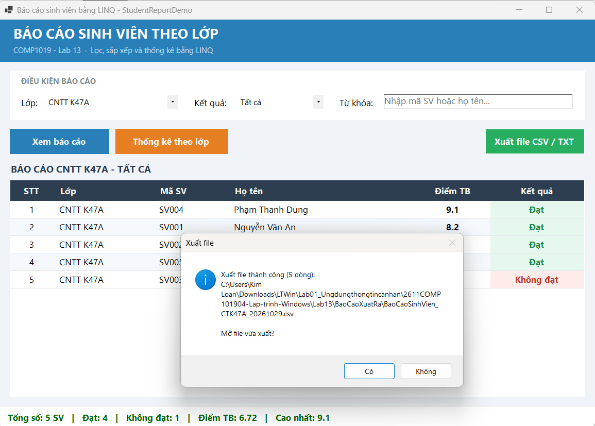
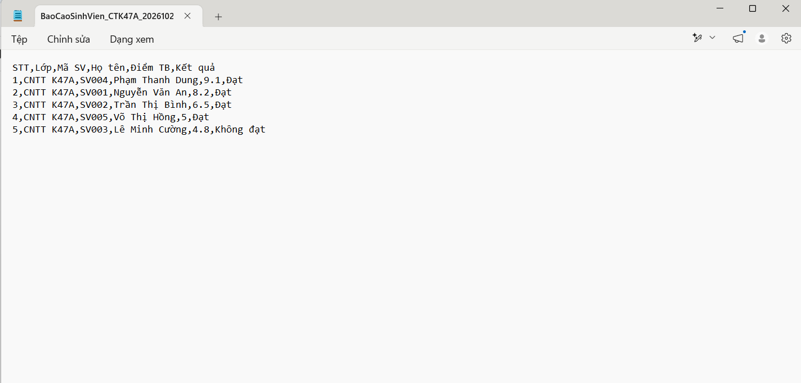
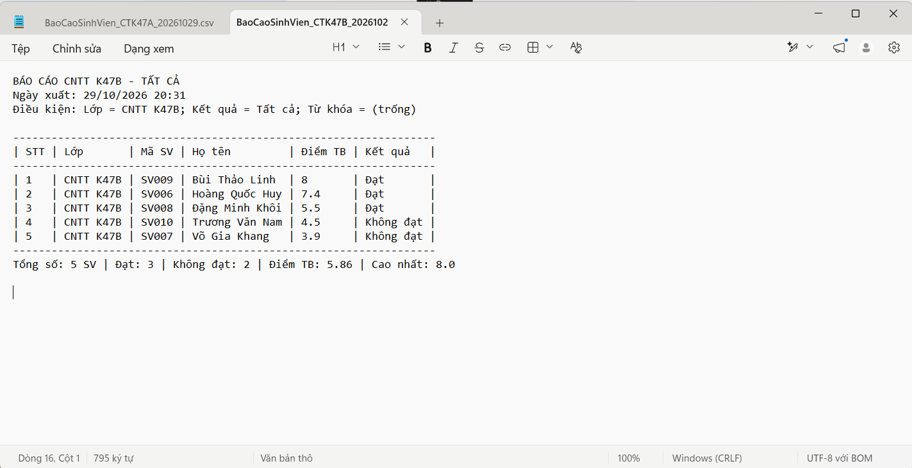
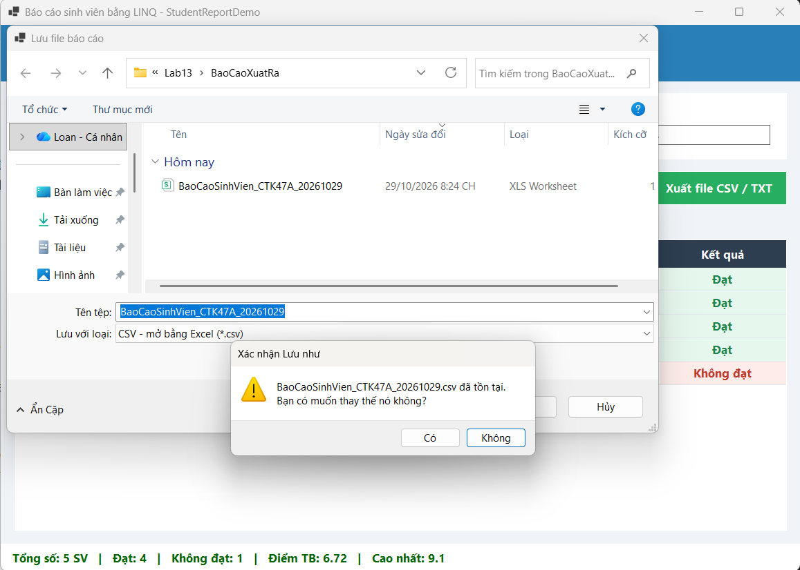

# LAB 13 - BÁO CÁO SINH VIÊN BẰNG LINQ

## 1. Thông tin sinh viên

Họ và tên: Lê Thị Kim Loan

MSSV: 49.01.103.045

Lớp: 49.01.SPTIN.A

## 2. Mô tả

Module **Báo cáo danh sách sinh viên theo lớp** (form `FrmBaoCaoSinhVien`). Người dùng chọn lớp,
chọn kết quả học tập (Tất cả / Đạt / Không đạt), nhập từ khóa và xem báo cáo. Chương trình dùng
**LINQ** để lọc, sắp xếp, chọn dữ liệu, nhóm và thống kê theo lớp; kết quả hiển thị trên
DataGridView và có thể xuất ra file **CSV** hoặc **TXT**. Dữ liệu là danh sách `List<SinhVien>`
tạo sẵn trong chương trình (không dùng database).

## 3. Công nghệ sử dụng

- C# Windows Forms, .NET 8, Visual Studio 2022
- LINQ: `Where`, `OrderByDescending`, `ThenBy`, `Select`, `Distinct`, `Prepend`, `GroupBy`, `Count`, `Average`, `Max`
- DataGridView, ComboBox, StatusStrip
- SaveFileDialog, `File.WriteAllText` (UTF-8)

## 4. Cấu trúc thư mục

```
Lab13
├── StudentReportDemo
│   ├── Program.cs
│   ├── Models
│   │   └── SinhVien.cs                 (model, KetQua là thuộc tính chỉ đọc)
│   └── Forms
│       ├── FrmBaoCaoSinhVien.cs        (TaoDuLieuMau, LoadComboBox, XemBaoCao, CapNhatThongKe, XuatFile...)
│       └── FrmBaoCaoSinhVien.Designer.cs
├── BaoCaoXuatRa                        (file CSV / TXT đã xuất)
├── screenshots
└── README.md
```

## 5. Model SinhVien và dữ liệu mẫu

| Thuộc tính | Kiểu | Ghi chú |
| --- | --- | --- |
| MaSV | string | Mã sinh viên |
| HoTen | string | Họ tên |
| MaLop | string | Mã lớp |
| TenLop | string | Tên lớp |
| Diem | double | Điểm trung bình |
| KetQua | string (chỉ đọc) | "Đạt" nếu Diem >= 5, ngược lại "Không đạt" |

Dữ liệu mẫu: **15 sinh viên, 3 lớp** (CNTT K47A, CNTT K47B, CNTT K48A), mỗi lớp 5 sinh viên.

## 6. Giao diện

| Control | Tên | Chức năng |
| --- | --- | --- |
| ComboBox | cboLop | Chọn lớp (có thêm mục "(Tất cả các lớp)") |
| ComboBox | cboKetQua | Tất cả / Đạt / Không đạt |
| TextBox | txtTuKhoa | Tìm theo mã hoặc họ tên |
| Button | btnXemBaoCao | Lọc và hiển thị báo cáo |
| Button | btnThongKe | Thống kê theo lớp |
| Button | btnXuatFile | Xuất CSV / TXT |
| DataGridView | dgvBaoCao | Hiển thị kết quả |
| ToolStripStatusLabel | lblThongKe | Tổng số, số đạt, số không đạt, điểm TB, điểm cao nhất |
| Label | lblTieuDe | Tiêu đề báo cáo đang xem |

Trình bày: dải tiêu đề xanh, khung điều kiện màu trắng, nút phẳng có hiệu ứng khi rê chuột,
tiêu đề cột lưới nền xanh đậm, dòng xen màu, cột Kết quả dạng nhãn màu (Đạt xanh, Không đạt đỏ).

## 7. Chức năng

| STT | Chức năng | Cách thực hiện |
| --- | --- | --- |
| 1 | Mở form load lớp và kết quả | `LoadComboBox()`: LINQ `Select` + `Distinct` + `OrderBy` lấy danh sách lớp |
| 2 | Lọc theo lớp, kết quả, từ khóa | `XemBaoCao()`: nối các `Where` theo điều kiện, tìm không phân biệt hoa thường |
| 3 | Sắp xếp giảm dần theo điểm | `OrderByDescending(Diem).ThenBy(HoTen)`; `Select` chọn cột và đánh STT |
| 4 | Thống kê theo lớp | `GroupBy(MaLop, TenLop)` → sĩ số, số đạt, không đạt, tỉ lệ đạt, điểm TB, điểm cao nhất |
| 5 | Xuất file | `XuatFile()`: SaveFileDialog, CSV chuẩn hoặc TXT dạng báo cáo, UTF-8 |
| 6 | Không có dữ liệu | Bấm "Xem báo cáo" → thông báo kèm điều kiện đang lọc; tự lọc → dòng chữ đỏ dưới đáy |
| 7 | Dùng LINQ | Toàn bộ lọc, sắp xếp, nhóm, đếm, trung bình đều bằng LINQ |

Xử lý lỗi khi xuất file: không có dữ liệu, file đang mở trong Excel (IOException), không có quyền ghi
(UnauthorizedAccessException), lỗi khác.

## 8. Cách chạy

1. Mở `StudentReportDemo/StudentReportDemo.csproj` (hoặc file .sln) bằng Visual Studio 2022.
2. Bấm F5. Không cần cài thêm thư viện hay database.

## 9. Kiểm thử

| STT | Tình huống | Thao tác | Kết quả mong đợi | Kết quả |
| --- | --- | --- | --- | --- |
| 1 | Mở form | Chạy chương trình | Báo cáo CNTT K47A: 5 SV, điểm giảm dần (9.1 → 4.8); Đạt 4, Không đạt 1, ĐTB 6.72 | Đúng |
| 2 | Lọc không đạt | (Tất cả các lớp) + Không đạt | 4 SV: 4.8, 4.5, 4.2, 3.9; ĐTB 4.35 | Đúng |
| 3 | Tìm từ khóa | (Tất cả các lớp) + Tất cả + "võ" | Võ Thị Hồng, Võ Gia Khang | Đúng |
| 4 | Sắp xếp trùng điểm | CNTT K48A | Lý Thanh Tâm 6.0 đứng trước Ngô Tuấn Minh 6.0 (ThenBy họ tên) | Đúng |
| 5 | Không có dữ liệu | CNTT K47A + Không đạt + "an" → Xem báo cáo | Thông báo không có sinh viên phù hợp | Đúng |
| 6 | Thống kê theo lớp | Bấm "Thống kê theo lớp" | 3 lớp: K47A 5/4/1 ĐTB 6.72; K47B 5/3/2 ĐTB 5.86; K48A 5/4/1 ĐTB 6.66 | Đúng |
| 7 | Xuất CSV | Xuất báo cáo CNTT K47A | File CSV mở được, đúng tiếng Việt, điểm dạng 8.2 | Đúng |
| 8 | Xuất TXT | Xuất cùng báo cáo, chọn .txt | Báo cáo có tiêu đề, điều kiện, bảng căn cột, thống kê | Đúng |
| 9 | Lỗi file đang mở | Mở file CSV trong Excel rồi xuất đè | Thông báo đóng file rồi thử lại | Đúng |

## 10. File báo cáo đã xuất

Nằm trong thư mục `BaoCaoXuatRa/`:

| File | Nội dung |
| --- | --- |
| [BaoCaoSinhVien_CTK47A_20261029.csv](BaoCaoXuatRa/BaoCaoSinhVien_CTK47A_20261029.csv) | Báo cáo lớp CNTT K47A, tất cả kết quả (CSV, mở bằng Excel) |
| [BaoCaoSinhVien_CTK47A_20261029.txt](BaoCaoXuatRa/BaoCaoSinhVien_CTK47A_20261029.txt) | Cùng báo cáo, dạng văn bản có tiêu đề, điều kiện lọc, bảng căn cột |
| [ThongKeTheoLop_20261029.csv](BaoCaoXuatRa/ThongKeTheoLop_20261029.csv) | Thống kê 3 lớp: sĩ số, số đạt, không đạt, tỉ lệ đạt, điểm TB, cao nhất |

## 11. Hình ảnh màn hình

### 11.1. Mở form - báo cáo CNTT K47A
Điểm sắp xếp giảm dần; Tổng 5, Đạt 4, Không đạt 1, Điểm TB 6.72.



### 11.2. Lọc sinh viên không đạt (tất cả các lớp)
4 sinh viên, Điểm TB 4.35.



### 11.3. Tìm theo từ khóa "võ"



### 11.4. Sắp xếp khi trùng điểm (CNTT K48A)
Lý Thanh Tâm và Ngô Tuấn Minh cùng 6.0, xếp theo họ tên.



### 11.5. Không có dữ liệu phù hợp



### 11.6. Thống kê theo lớp (GroupBy)



### 11.7. Xuất file thành công



### 11.8. File CSV đã xuất



### 11.9. File TXT đã xuất



### 11.10. Lỗi khi file đang mở trong Excel


