# LAB 14 - ENTITY FRAMEWORK CORE VÀ MÔ HÌNH BA LỚP

## 1. Thông tin sinh viên

| Thông tin | Nội dung |
| --- | --- |
| Họ và tên | Lê Thị Kim Loan  |
| MSSV | 49.01.103.045  |
| Lớp | 49.01.SPTINA |
| Học phần | COMP1019 - Lập trình trên Windows |
| Bài | Buổi 14 - Lab 14: Entity Framework và mô hình ba lớp |

## 2. Mô tả

Module **Quản lý môn học** của hệ thống EduManager (form `FrmMonHoc`). Người dùng xem, thêm, sửa,
xóa và tìm kiếm môn học trong bảng `MONHOC` của database `EduManagerDB` trên SQL Server.
Dữ liệu được truy cập bằng **Entity Framework Core** (không viết câu SQL trong C#) và mã nguồn
được tổ chức theo **mô hình ba lớp GUI - BLL - DAL**.

## 3. Công nghệ sử dụng

- C# Windows Forms, .NET 8, Visual Studio 2022
- Entity Framework Core 8 (`Microsoft.EntityFrameworkCore.SqlServer`)
- Microsoft SQL Server, SSMS
- LINQ (truy vấn qua `DbSet<MonHoc>`)

## 4. Kiến trúc ba lớp

| Lớp | File | Trách nhiệm |
| --- | --- | --- |
| GUI | `GUI/FrmMonHoc.cs` | Nhận dữ liệu từ control, gọi BLL, hiển thị kết quả, hỏi xác nhận xóa. Không có câu SQL, không có quy tắc nghiệp vụ |
| BLL | `BLL/MonHocBLL.cs` | Chuẩn hóa và kiểm tra dữ liệu (rỗng, độ dài, số tín chỉ 1-6, trùng mã) trước khi gọi DAL; đổi lỗi database thành thông báo dễ hiểu; trả về `KetQuaXuLy` |
| DAL | `DAL/MonHocDAL.cs` | Đọc / ghi bảng MONHOC bằng EF Core (`ToList`, `Where`, `Any`, `Add`, `Find`, `Remove`, `SaveChanges`) |
| Model | `Models/MonHoc.cs` | Entity ánh xạ bảng MONHOC |
| Data | `Data/EduManagerContext.cs` | DbContext, `DbSet<MonHoc>`, connection string |

Luồng xử lý: `FrmMonHoc` → `MonHocBLL` → `MonHocDAL` → `EduManagerContext` → SQL Server.

## 5. Cơ sở dữ liệu

Script: `Database/Lab14_MONHOC.sql` (tạo EduManagerDB nếu chưa có, tạo bảng MONHOC, 8 môn học mẫu).

| Cột | Kiểu | Ràng buộc |
| --- | --- | --- |
| MaMonHoc | nvarchar(10) | Khóa chính |
| TenMonHoc | nvarchar(100) | NOT NULL |
| SoTinChi | int | CHECK 1 - 6 |
| TrangThai | bit | DEFAULT 1 (1 = còn sử dụng) |

Ghi chú: nếu database đã có bảng MONHOC kiểu Lab 10 (cột MaMH), script đổi tên bảng đó thành
`MONHOC_Lab10` để giữ dữ liệu cũ rồi mới tạo bảng MONHOC mới.

Connection string (trong `Data/EduManagerContext.cs`):

```
Data Source=.;Initial Catalog=EduManagerDB;Integrated Security=True;TrustServerCertificate=True
```

## 6. Cấu trúc thư mục

```
Lab14
├── EduManager
│   ├── Models/MonHoc.cs
│   ├── Data/EduManagerContext.cs
│   ├── DAL/MonHocDAL.cs
│   ├── BLL/MonHocBLL.cs
│   ├── GUI/FrmMonHoc.cs, FrmMonHoc.Designer.cs
│   └── Program.cs
├── Database/Lab14_MONHOC.sql
├── screenshots
└── README.md
```

## 7. Giao diện

| Control | Tên | Chức năng |
| --- | --- | --- |
| TextBox | txtMaMonHoc | Mã môn học (tối đa 10 ký tự, tự viết hoa, bị khóa khi đang chọn môn) |
| TextBox | txtTenMonHoc | Tên môn học |
| NumericUpDown | nudSoTinChi | Số tín chỉ 1 - 6 |
| CheckBox | chkTrangThai | Còn sử dụng |
| TextBox | txtTimKiem | Từ khóa tìm theo mã hoặc tên (Enter để tìm) |
| DataGridView | dgvMonHoc | Danh sách môn học, cột Trạng thái tô màu |
| Button | btnThem, btnSua, btnXoa, btnLamMoi, btnTimKiem | Thêm, Sửa, Xóa, Làm mới, Tìm kiếm |
| StatusStrip | lblThongBao, lblTongSo | Kết quả thao tác; tổng số môn, đang dùng, ngừng, tổng tín chỉ |

## 8. Chức năng

| STT | Chức năng | Cách thực hiện |
| --- | --- | --- |
| 1 | Load danh sách khi mở form | `FrmMonHoc_Load` → `MonHocBLL.LayDanhSach` → `MonHocDAL.LayTatCa` |
| 2 | Thêm môn học | `MonHocBLL.Them`: chuẩn hóa, kiểm tra, kiểm tra trùng mã → `MonHocDAL.Them` |
| 3 | Sửa môn học | Phải chọn dòng trước; `MonHocBLL.Sua` → `MonHocDAL.Sua` (không cho sửa mã) |
| 4 | Xóa môn học | Phải chọn dòng; hỏi xác nhận (mặc định No) → `MonHocBLL.Xoa` → `MonHocDAL.Xoa` |
| 5 | Tìm kiếm | Theo mã hoặc tên, EF Core sinh `LIKE '%từ khóa%'` |
| 6 | Chọn dòng đưa dữ liệu lên form | `dgvMonHoc_CellClick`, khóa ô mã |
| 7 | Làm mới | Xóa ô nhập, mở khóa mã, tải lại danh sách |

## 9. Validation (đặt tại BLL)

| Kiểm tra | Thông báo |
| --- | --- |
| Mã môn học rỗng | Mã môn học không được để trống. |
| Mã > 10 ký tự hoặc có khoảng trắng | Mã môn học tối đa 10 ký tự / không được chứa khoảng trắng. |
| Tên môn học rỗng hoặc > 100 ký tự | Tên môn học không được để trống / tối đa 100 ký tự. |
| Số tín chỉ ngoài 1 - 6 | Số tín chỉ phải từ 1 đến 6. |
| Thêm mã đã tồn tại | Mã môn học "..." đã tồn tại. |
| Không kết nối được SQL Server | Không kết nối được cơ sở dữ liệu EduManagerDB... (kèm hướng dẫn kiểm tra) |

Khi có lỗi, con trỏ được đưa về đúng ô nhập bị sai. Xóa luôn hỏi xác nhận bằng MessageBox (ở GUI).

## 10. Cách chạy

1. Mở SSMS, chạy `Database/Lab14_MONHOC.sql` (F5).
2. Mở `EduManager/EduManager.csproj` (hoặc file .sln) bằng Visual Studio 2022.
   Gói `Microsoft.EntityFrameworkCore.SqlServer` được tự khôi phục khi build.
3. Nếu máy dùng SQL Express, sửa `Data Source` trong `Data/EduManagerContext.cs` thành `.\SQLEXPRESS`.
4. Bấm F5.

## 11. Kiểm thử

| STT | Tình huống | Dữ liệu | Kết quả mong đợi | Kết quả |
| --- | --- | --- | --- | --- |
| 1 | Mở form | - | 8 môn học; Tổng 8, đang dùng 7, ngừng 1, 21 tín chỉ | Đúng |
| 2 | Thêm hợp lệ | COMP1050, Lập trình Web, 3, đang dùng | Thêm thành công; có trong SSMS | Đúng |
| 3 | Thiếu mã | Mã rỗng | "Mã môn học không được để trống", con trỏ về ô mã | Đúng |
| 4 | Thiếu tên | TEST01, tên rỗng | "Tên môn học không được để trống" | Đúng |
| 5 | Trùng mã | COMP1019 | "Mã môn học "COMP1019" đã tồn tại" | Đúng |
| 6 | Sửa khi chưa chọn | Bấm Sửa ngay | "Vui lòng chọn môn học cần sửa" | Đúng |
| 7 | Sửa hợp lệ | COMP1050 → Lập trình Web nâng cao, 4 tín chỉ, ngừng | Cập nhật thành công, nhãn Ngừng sử dụng | Đúng |
| 8 | Xóa | Chọn COMP1050 → Xóa → Yes | Hỏi xác nhận, xóa thành công | Đúng |
| 9 | Tìm kiếm | "lập trình" | COMP1017, COMP1019 | Đúng |
| 10 | Không tìm thấy | "xyz" | Thông báo không tìm thấy | Đúng |

## 12. Trả lời câu hỏi

**1. Vì sao không nên viết toàn bộ code CRUD trong sự kiện Button Click?**
Hàm Click sẽ vừa đọc control, vừa kiểm tra dữ liệu, vừa truy cập database nên rất dài và khó đọc;
cùng một đoạn kiểm tra hay truy vấn phải chép lại ở nhiều nút; không kiểm thử riêng được phần
nghiệp vụ; muốn đổi database hay đổi giao diện (ví dụ làm thêm bản Web) phải sửa lẫn lộn mọi thứ.
Tách ra GUI - BLL - DAL thì mỗi phần một việc, dùng lại được và dễ sửa.

**2. BLL và DAL khác nhau ở điểm nào?**
DAL chỉ biết **cách lấy và lưu dữ liệu** (EF Core, bảng, SaveChanges), không quan tâm dữ liệu
đúng hay sai về nghiệp vụ. BLL chứa **quy tắc nghiệp vụ**: mã không rỗng, tín chỉ 1-6, không trùng
mã, chuẩn hóa dữ liệu, rồi mới gọi DAL; BLL không biết database là SQL Server hay gì khác.

**3. Entity Framework khác ADO.NET ở điểm nào?**
ADO.NET: tự viết câu SQL, tự tạo SqlConnection / SqlCommand / SqlParameter, tự đọc từng cột từ
DataTable hay DataReader. Entity Framework là ORM: làm việc với đối tượng C# (`MonHoc`) và LINQ,
EF tự sinh câu SQL có tham số, tự ánh xạ dòng ↔ đối tượng, theo dõi thay đổi và lưu bằng
`SaveChanges()`. Code ngắn hơn, ít lỗi gõ SQL hơn; đổi lại khó kiểm soát câu SQL chi tiết và
chậm hơn một chút với truy vấn phức tạp.

**4. Trong bài lab này, validation nào nên đặt ở BLL?**
Mã môn học không rỗng, không quá 10 ký tự, không có khoảng trắng; tên môn học không rỗng, không
quá 100 ký tự; số tín chỉ từ 1 đến 6; không thêm mã đã tồn tại; chuẩn hóa dữ liệu (bỏ khoảng trắng
thừa, viết hoa mã). Riêng việc hỏi xác nhận khi xóa và kiểm tra "đã chọn dòng chưa" thuộc về giao
diện nên đặt ở GUI.

## 13. Hình ảnh màn hình

### 13.1. Database - bảng MONHOC
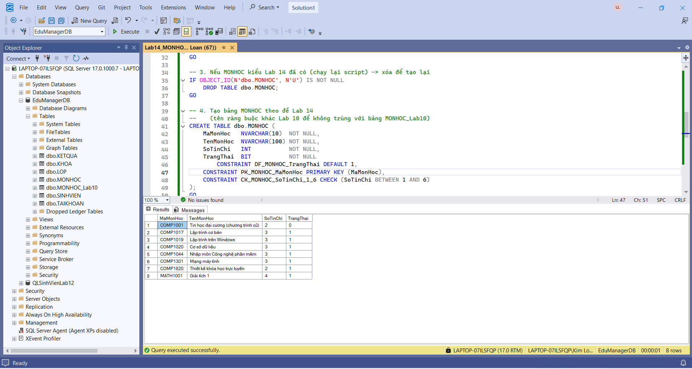

### 13.2. Mở form - load danh sách
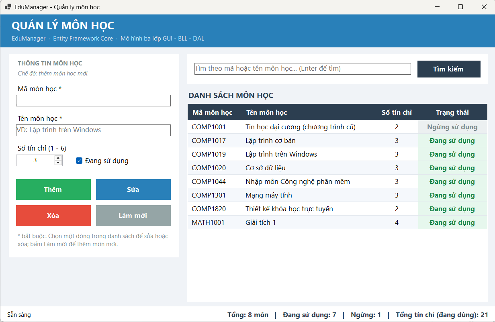

### 13.3. Thêm môn học thành công
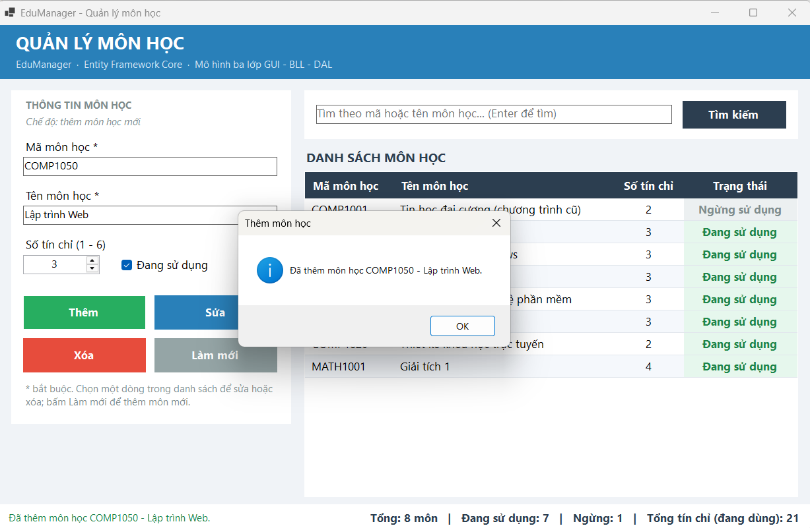

### 13.4. Kiểm tra trong SQL Server sau khi thêm
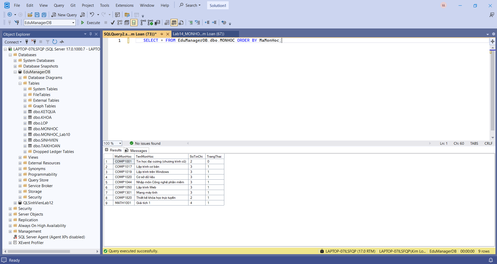

### 13.5. Validation - thiếu mã môn học
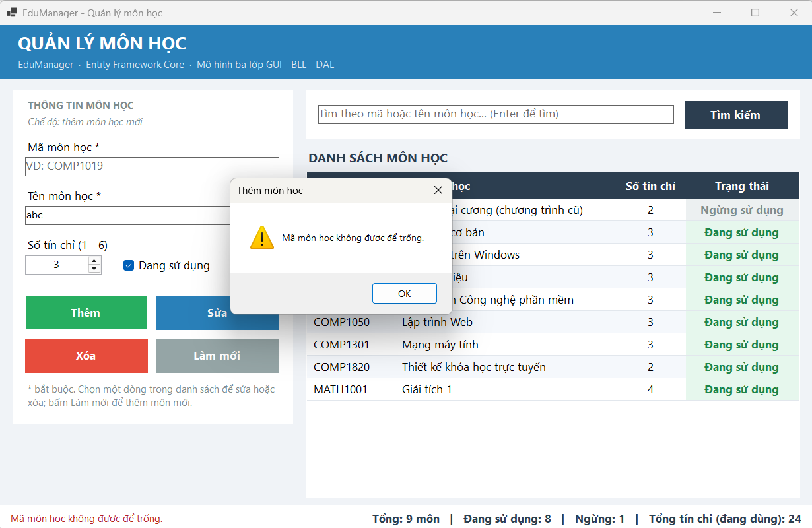

### 13.6. Validation - thiếu tên môn học
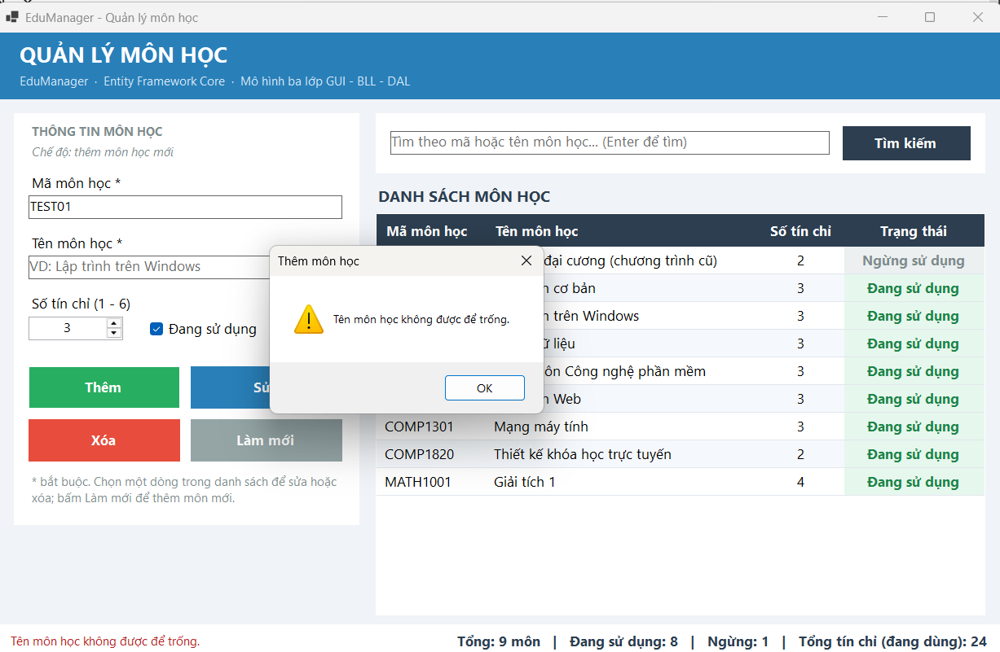

### 13.7. Validation - trùng mã môn học
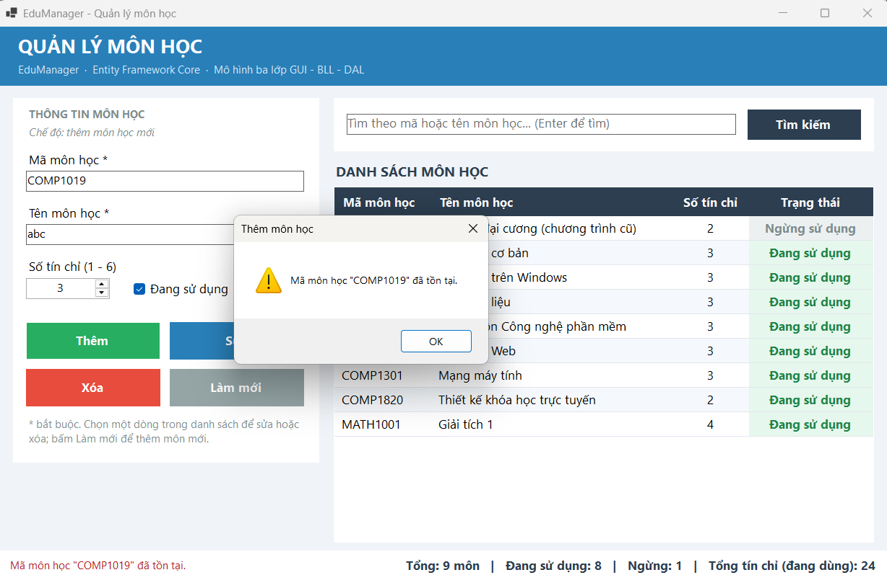

### 13.8. Sửa khi chưa chọn môn học
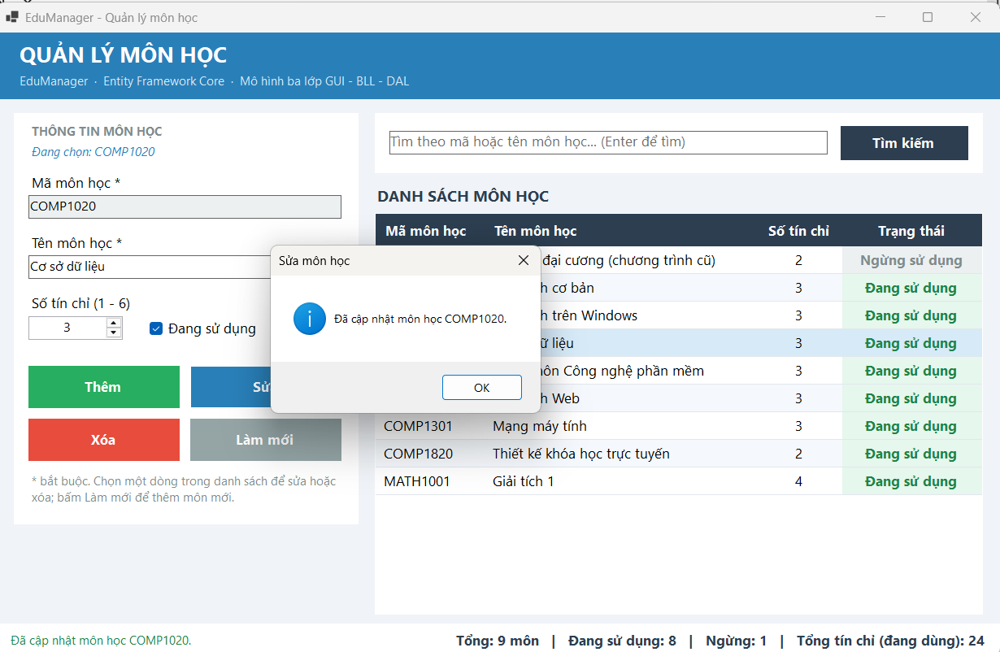

### 13.9. Sửa môn học thành công
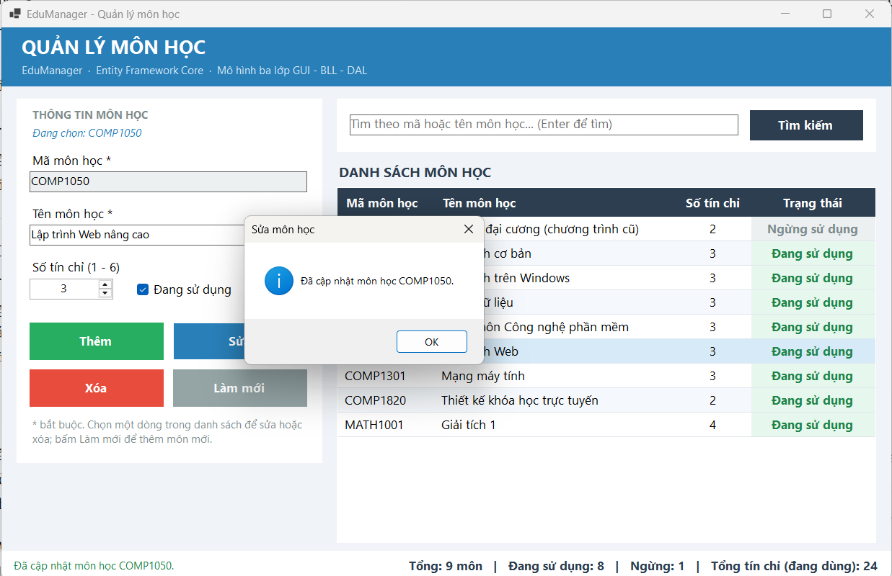

### 13.10. Xác nhận xóa
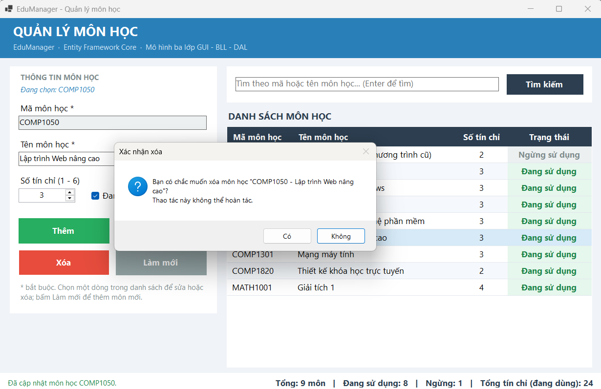

### 13.11. Tìm kiếm
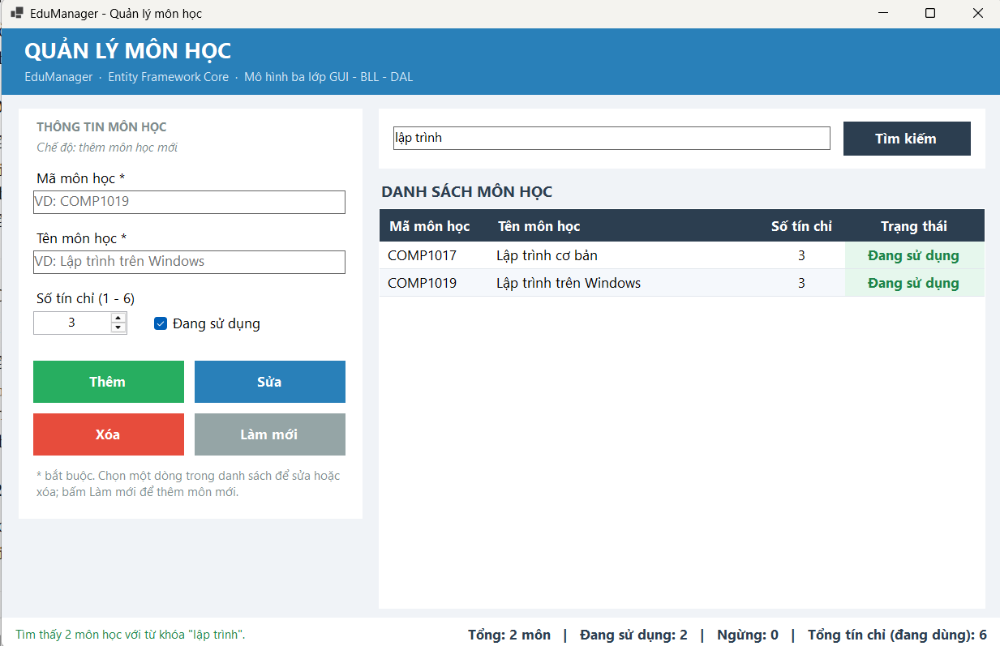

### 13.12. Không tìm thấy
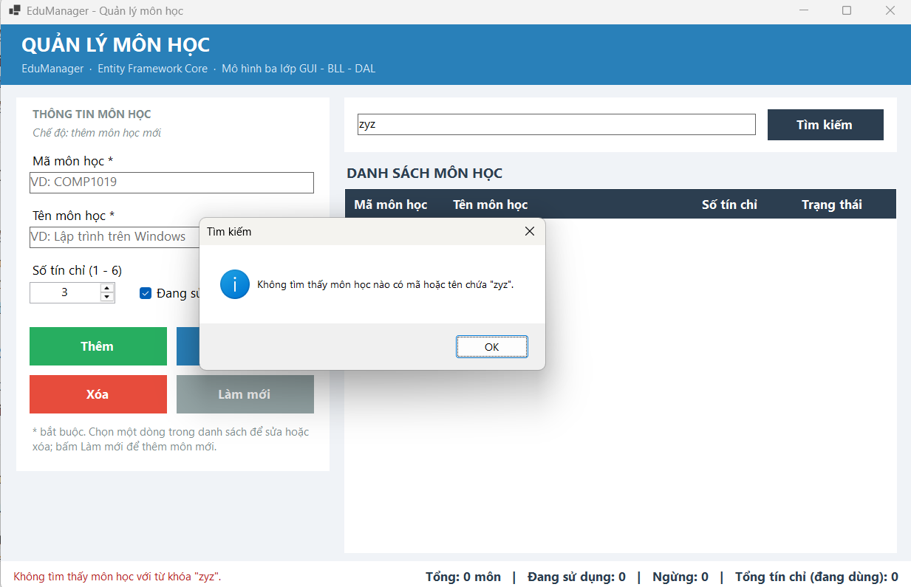