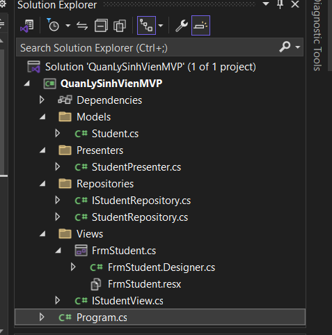
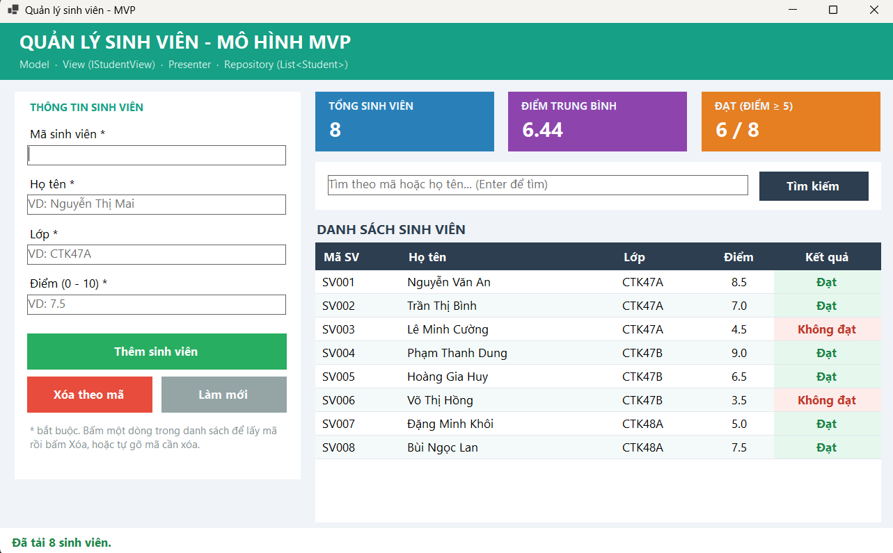
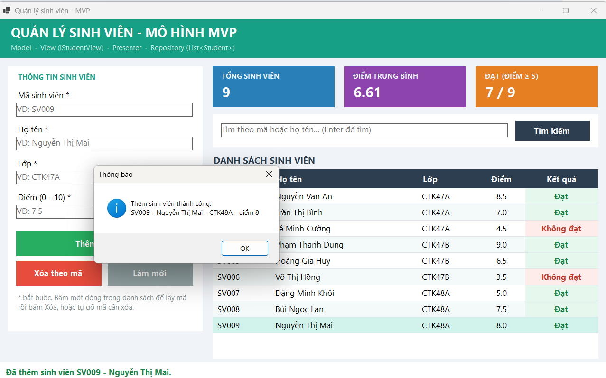
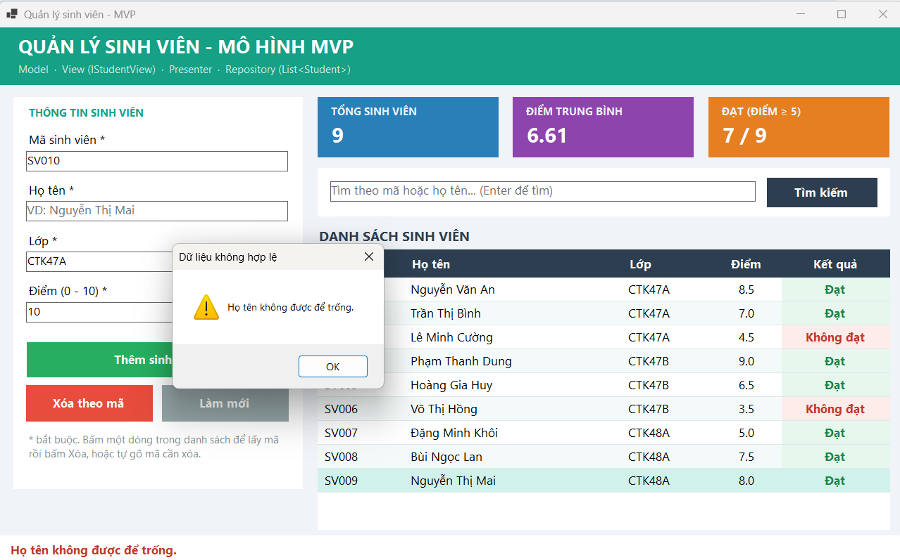
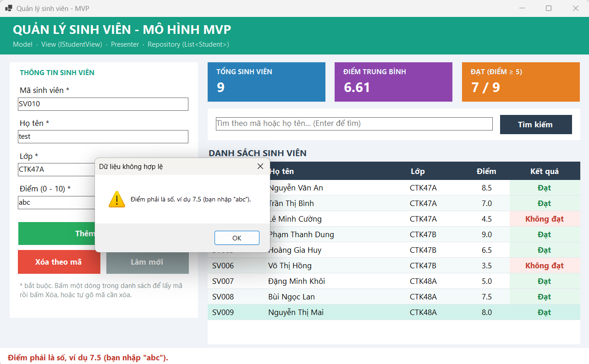
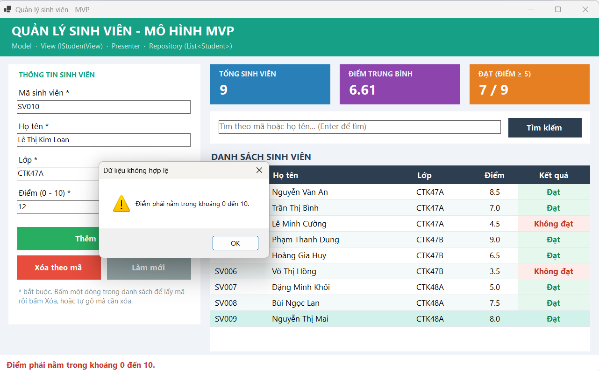
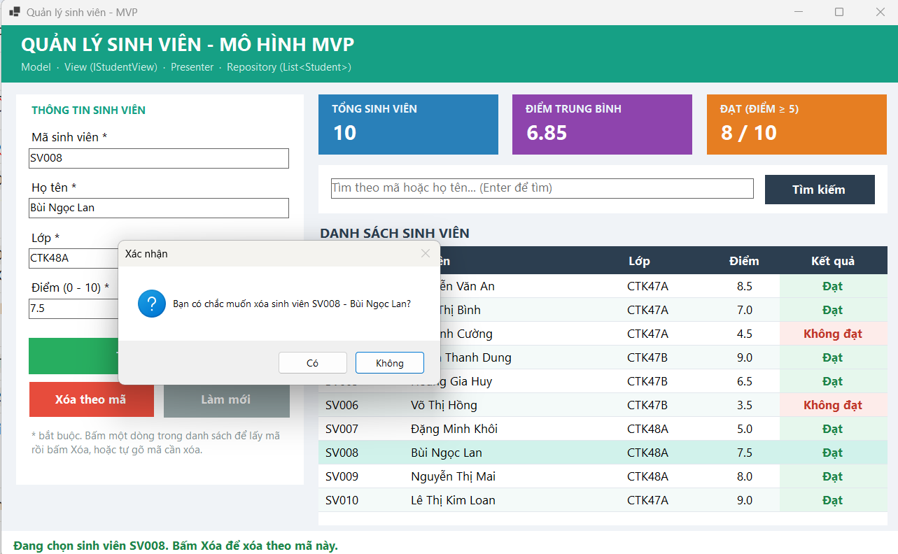
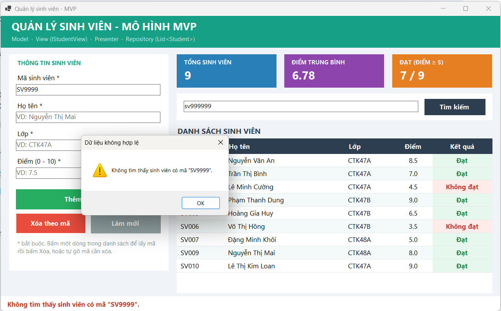
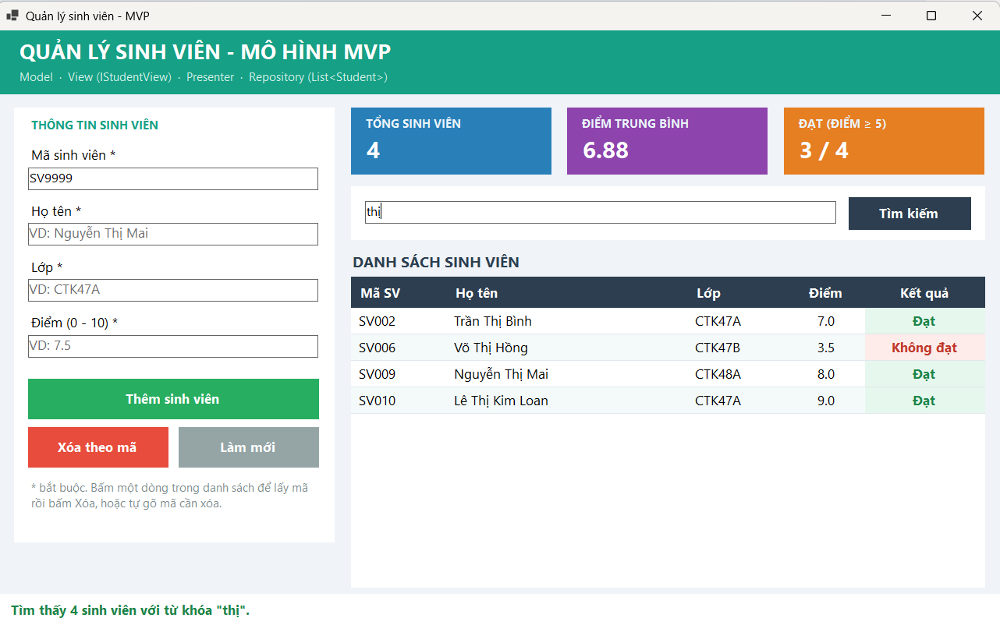
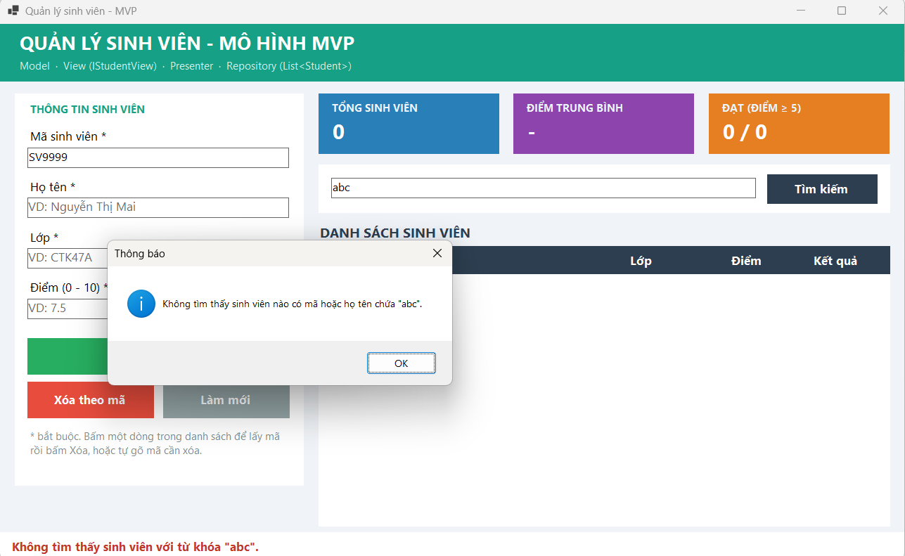

# LAB 15 - MVP, KIỂM THỬ VÀ BÀN GIAO ĐỒ ÁN

## 1. Thông tin sinh viên

| Thông tin | Nội dung |
| --- | --- |
| Họ và tên | Lê Thị Kim Loan  |
| MSSV | 49.01.103.045 |
| Lớp | 49.01.SPTINA  |
| Học phần | COMP1019 - Lập trình trên Windows |
| Bài | Buổi 15 - Lab 15: MVP, kiểm thử và bàn giao đồ án |

## 2. Mô tả

Module **Quản lý sinh viên** được tổ chức theo mô hình **MVP (Model - View - Presenter)**.
Form chỉ nhận thao tác của người dùng và hiển thị; mọi xử lý (kiểm tra dữ liệu, thêm, xóa, tìm kiếm)
nằm trong Presenter; dữ liệu được lưu qua Repository bằng `List<Student>` với 8 sinh viên mẫu.

## 3. Công nghệ sử dụng

- C# Windows Forms, .NET 8, Visual Studio 2022
- Mô hình MVP với interface View (`IStudentView`) và interface Repository (`IStudentRepository`)
- LINQ trên `List<Student>`

## 4. Kiến trúc MVP

| Thành phần | File | Trách nhiệm |
| --- | --- | --- |
| Model | `Models/Student.cs` | Dữ liệu sinh viên: MaSV, HoTen, Lop, Diem, KetQua (chỉ đọc) |
| View (interface) | `Views/IStudentView.cs` | Các thuộc tính và phương thức Presenter được dùng để đọc dữ liệu nhập và yêu cầu hiển thị |
| View (Form) | `Views/FrmStudent.cs` | `FrmStudent : Form, IStudentView`; mỗi nút bấm chỉ gọi một phương thức của Presenter |
| Presenter | `Presenters/StudentPresenter.cs` | Kiểm tra dữ liệu, gọi Repository, yêu cầu View hiển thị; không truy cập TextBox / DataGridView |
| Repository | `Repositories/IStudentRepository.cs`, `StudentRepository.cs` | Lưu và truy xuất sinh viên bằng `List<Student>` |

Luồng xử lý khi bấm **Thêm**: `btnThem_Click` → `_presenter.AddStudent()` → Presenter đọc
`view.StudentCode`, `view.FullName`, `view.ClassName`, `view.ScoreText` → kiểm tra → `repository.Add()` →
`view.ShowStudents()`, `view.ShowStatistics()`, `view.ShowMessage()`.

Các nút bấm trong Form:

```csharp
private void btnThem_Click(object sender, EventArgs e)    => _presenter.AddStudent();
private void btnXoa_Click(object sender, EventArgs e)     => _presenter.DeleteStudent();
private void btnTimKiem_Click(object sender, EventArgs e) => _presenter.SearchStudent();
private void btnLamMoi_Click(object sender, EventArgs e)  => _presenter.ResetForm();
```

## 5. Cấu trúc thư mục

```
Lab15
├── QuanLySinhVienMVP
│   ├── Models/Student.cs
│   ├── Views/IStudentView.cs, FrmStudent.cs, FrmStudent.Designer.cs
│   ├── Presenters/StudentPresenter.cs
│   ├── Repositories/IStudentRepository.cs, StudentRepository.cs
│   └── Program.cs
├── screenshots
├── README.md
├── README.txt
├── TestCases.md
└── ChecklistBanGiao.md
```

## 6. Giao diện

| Control | Tên | Chức năng |
| --- | --- | --- |
| TextBox | txtMaSV, txtHoTen, txtLop, txtDiem | 4 ô nhập liệu |
| TextBox | txtTimKiem | Từ khóa tìm theo mã hoặc họ tên (Enter để tìm) |
| DataGridView | dgvSinhVien | Danh sách sinh viên, cột Kết quả tô màu |
| Button | btnThem, btnXoa, btnTimKiem, btnLamMoi | Thêm, Xóa theo mã, Tìm kiếm, Làm mới |
| Panel (thẻ màu) | pnlCardTong, pnlCardDiem, pnlCardDat | Tổng sinh viên, điểm trung bình, số đạt |
| StatusStrip | lblThongBao | Kết quả thao tác gần nhất |

## 7. Chức năng và kiểm tra dữ liệu

| Chức năng | Phương thức Presenter | Kiểm tra |
| --- | --- | --- |
| Load danh sách | `LoadStudents()` | - |
| Thêm | `AddStudent()` | Rỗng (mã, tên, lớp, điểm); mã ≤ 10 ký tự, không khoảng trắng; điểm phải là số (sai kiểu); điểm 0 - 10; trùng mã |
| Xóa theo mã | `DeleteStudent()` | Mã rỗng; mã không tồn tại; hỏi xác nhận |
| Tìm kiếm | `SearchStudent()` | Từ khóa rỗng → hiện tất cả; không có kết quả → thông báo |
| Chọn dòng | `SelectStudent(ma)` | Đưa dữ liệu lên các ô nhập |
| Làm mới | `ResetForm()` | Xóa ô nhập, tải lại danh sách |

Mỗi thao tác đều có thông báo kết quả (MessageBox + thanh trạng thái) và con trỏ được đưa về đúng ô nhập bị sai.

## 8. Cách chạy

Xem `README.txt`. Tóm tắt: mở `QuanLySinhVienMVP.csproj` bằng Visual Studio 2022, bấm F5.
Không cần database, không có tài khoản đăng nhập.

## 9. Kiểm thử

Chi tiết 10 test case trong [TestCases.md](TestCases.md).

| ID | Chức năng | Kết quả |
| --- | --- | --- |
| TC01 | Load danh sách | Đạt |
| TC02 | Thêm hợp lệ | Đạt |
| TC03 | Thêm trùng mã | Đạt |
| TC04 | Dữ liệu rỗng | Đạt |
| TC05 | Sai kiểu dữ liệu | Đạt |
| TC06 | Điểm ngoài khoảng | Đạt |
| TC07 | Xóa theo mã | Đạt |
| TC08 | Xóa mã không tồn tại | Đạt |
| TC09 | Tìm kiếm | Đạt |
| TC10 | Tìm không có kết quả | Đạt |

## 10. Checklist bàn giao

Xem [ChecklistBanGiao.md](ChecklistBanGiao.md).

## 11. Hình ảnh màn hình

### 11.1. Cấu trúc project MVP


### 11.2. TC01 - Load danh sách


### 11.3. TC02 - Thêm hợp lệ


### 11.4. TC03 - Thêm trùng mã


### 11.5. TC04 - Dữ liệu rỗng


### 11.6. TC05 - Sai kiểu dữ liệu


### 11.7. TC06 - Điểm ngoài khoảng


### 11.8. TC07 - Xóa theo mã


### 11.9. TC08 - Xóa mã không tồn tại


### 11.10. TC09 - Tìm kiếm


### 11.11. TC10 - Không tìm thấy
